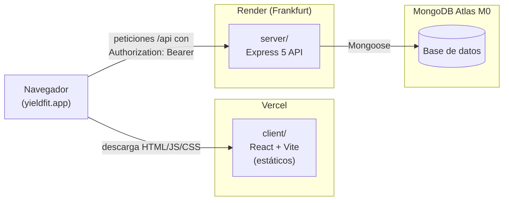
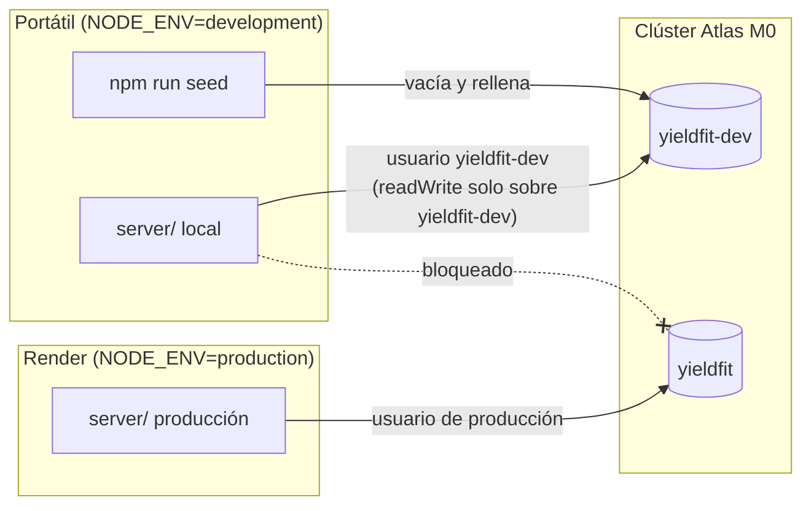
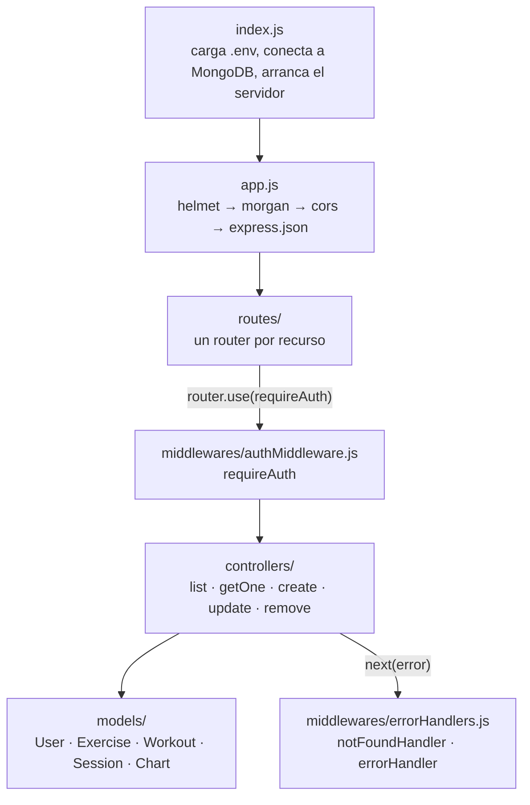
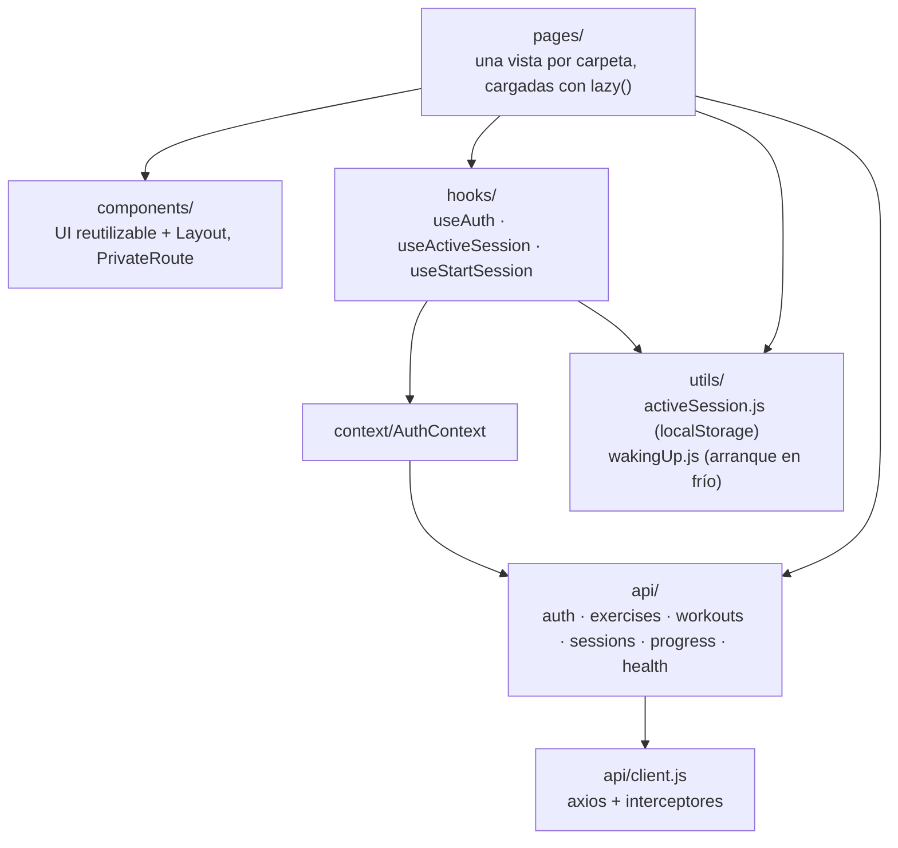
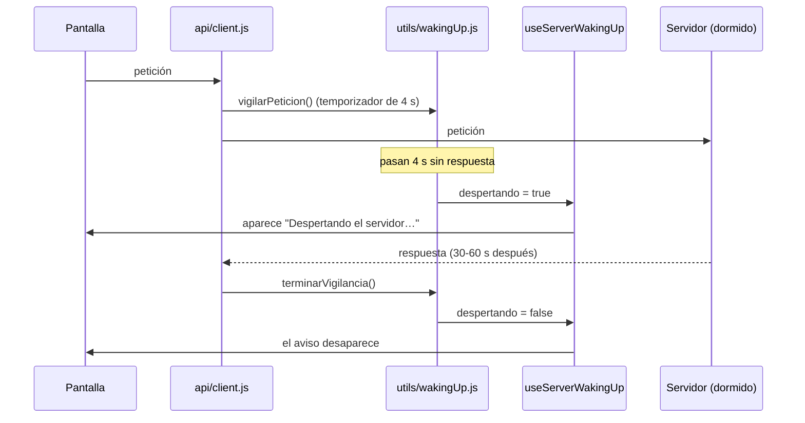
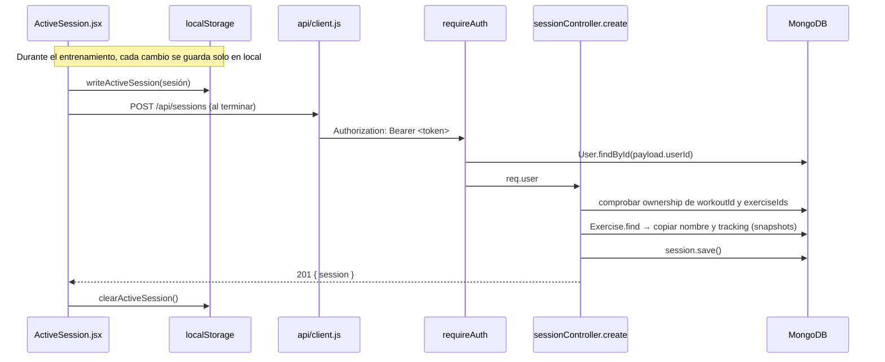

# Arquitectura

[← Índice](README.md)

## Despliegue

Tres piezas independientes, cada una en un servicio con plan gratuito ([0001](../DECISIONS.md)).
El frontend y el backend se despliegan por separado desde el mismo repo (`client/` y `server/`).

- El navegador descarga la app de Vercel y después habla **directamente** con la API de Render.
  Por eso son dos dominios distintos y la API necesita CORS (`CLIENT_ORIGINS`).
- **Cold start:** Render duerme el servicio tras un periodo sin tráfico; la primera petición
  tarda decenas de segundos. Se aborda en el bloque 3.

## Entornos

Desarrollo y producción usan bases distintas dentro del mismo clúster de Atlas
([0017](../DECISIONS.md)).

Tres barreras impiden que el entorno local escriba en producción:

| Barrera | Dónde | Qué hace |
|---|---|---|
| Permisos de Atlas | usuario `yieldfit-dev` | solo tiene `readWrite` sobre `yieldfit-dev`; Atlas rechaza cualquier operación sobre `yieldfit` |
| Comprobación al arrancar | `server/config/database.js` | si `NODE_ENV` no es `production` y la base es `yieldfit`, el servidor no arranca |
| Seed | `server/scripts/seed.js` | se niega a ejecutarse si la base no termina en `-dev` |

**Datos de desarrollo:** `npm run seed` (desde `server/`) vacía `yieldfit-dev` y crea un usuario de
prueba (`dev@yieldfit.test` / `desarrollo123`), los presets, tres rutinas, un grupo de progreso y
unas 3 sesiones por semana durante 2 años (`npm run seed -- --anios 5` para más historial). Los
datos son deterministas: siempre los mismos para los mismos argumentos.

## Backend (`server/`)

| Prefijo | Router | Protección |
|---|---|---|
| `/api/auth` | `authRoutes.js` | pública, salvo `GET /me` |
| `/api/exercises` | `exerciseRoutes.js` | `requireAuth` a nivel router |
| `/api/workouts` | `workoutRoutes.js` | `requireAuth` a nivel router |
| `/api/sessions` | `sessionRoutes.js` | `requireAuth` a nivel router; lista paginada por cursor ([0027](../DECISIONS.md)); `previous-sets` para la serie anterior ([0029](../DECISIONS.md)); `days` para el calendario ([0033](../DECISIONS.md)) |
| `/api/progress` | `progressRoutes.js` | `requireAuth` a nivel router; solo lectura ([0026](../DECISIONS.md)) |
| `/api/health` | en `app.js` | pública; despertador de la portada ([0025](../DECISIONS.md)) |
| `/api/charts` | `chartRoutes.js` | `requireAuth` a nivel router (sin uso en el cliente todavía) |

**Errores:** los controladores pasan los errores inesperados con `next(error)` a `errorHandler`.
En producción, un 500 responde siempre con un mensaje genérico, porque el cliente muestra
`response.data.message` y el mensaje original puede revelar detalles internos. El error completo
queda en los logs de Render. En desarrollo se devuelven el mensaje real y el `stack`. Los errores
< 500 (p. ej. un 400 por JSON mal formado) se devuelven tal cual.

Todos los recursos siguen el mismo patrón: cada query filtra por `userId: req.user._id` y, cuando
un documento referencia otros ids (`exerciseId`, `workoutId`), el controlador comprueba que
pertenecen al usuario antes de guardar.

## Cliente (`client/src/`)

- **`api/client.js`** es el único punto que habla con el backend: añade el token en cada
  petición, cronometra las peticiones para detectar el arranque en frío y, si recibe un 401 con
  token, borra el token y anuncia la sesión caducada (ver [auth.md](auth.md)).
- **Lógica de negocio fuera de los componentes:** el 1RM y el progreso se calculan en el
  servidor (`utils/unaRM.js`, `utils/progreso.js`, [0026](../DECISIONS.md)); el cliente solo los
  muestra. La sesión en curso vive en `utils/activeSession.js` ([0009](../DECISIONS.md)).
- **Fondos WebGL** ([0011](../DECISIONS.md)): `Dither` solo en Welcome (carga diferida);
  `DarkVeil` dentro de `Layout`, así que está en todas las pantallas privadas.

### Rutas

| Ruta | Página | Privada |
|---|---|---|
| `/` | Welcome | no |
| `/login`, `/register` | Login, Register | no |
| `/dashboard` | Dashboard | sí |
| `/exercises`, `/exercises/new`, `/exercises/:id/edit` | Exercises, ExerciseForm | sí |
| `/workouts`, `/workouts/new`, `/workouts/:id/edit` | Workouts, WorkoutForm | sí |
| `/sessions/active`, `/sessions/active/replace/:index` | ActiveSession, ReplaceExercise | sí |
| `/history`, `/history/:id` | History, SessionDetail | sí |
| `/profile` | Profile | sí |

Las rutas privadas van envueltas en `PrivateRoute` + `Layout`. Cualquier otra ruta redirige a `/`.

## Arranque en frío de Render

Con el plan gratuito, Render apaga el servidor tras ~15 minutos sin uso; la siguiente petición
tarda 30-60 s en responder ([0025](../DECISIONS.md)). El cliente no puede saber si el servidor está
dormido, pero sí que una petición tarda:

- **`utils/wakingUp.js`** es un tablón (pub-sub): los interceptores viven fuera de React, y el
  hook **`useServerWakingUp`** lo lee con `useSyncExternalStore`.
- **`ServerWakingUp`** muestra el aviso en `PrivateRoute` (validar el token al abrir la app), bajo
  el botón de Login y Register, y flotante en `Layout` (cualquier pantalla privada, p. ej. al
  volver tras un rato con la pestaña abierta).
- **Despertador:** la portada llama a `GET /api/health` al abrirse, para que el servidor vaya
  arrancando mientras el usuario lee.
- **Prueba en local:** `RETRASO_PRUEBA_MS=8000 npm run dev` (desde `server/`) retrasa cada
  petición. Se ignora siempre con `NODE_ENV=production`.

## Recorrido de una petición: guardar una sesión

