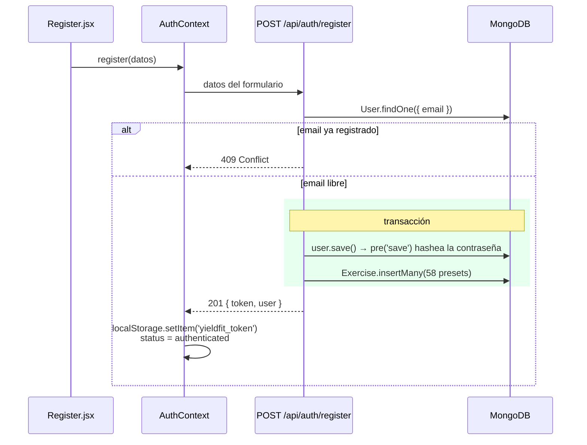
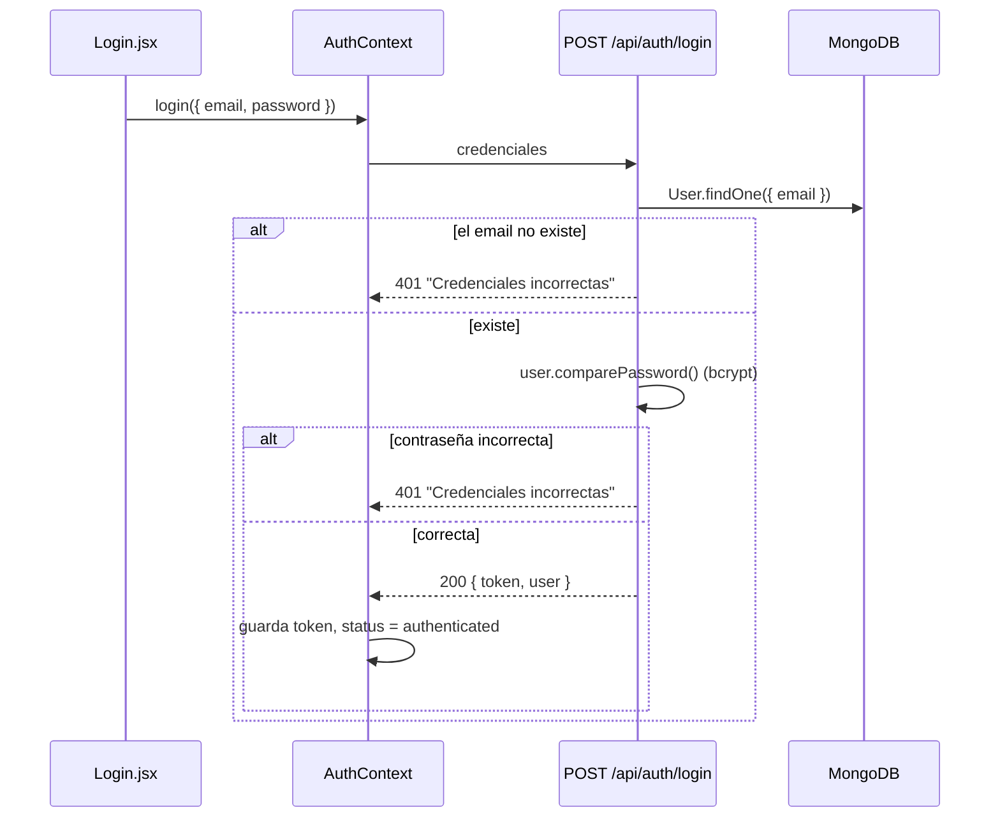
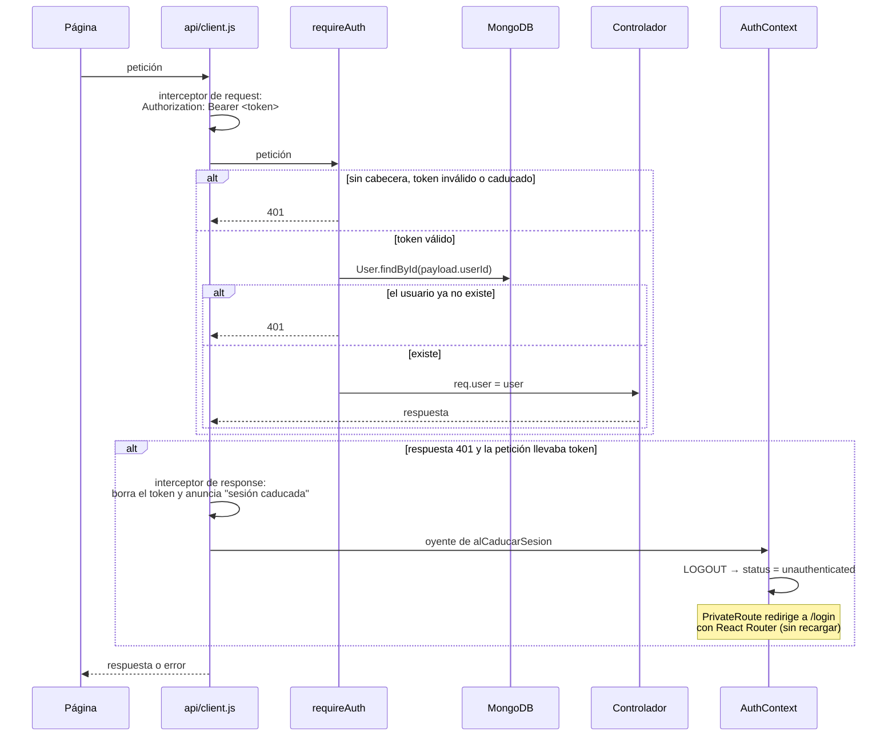
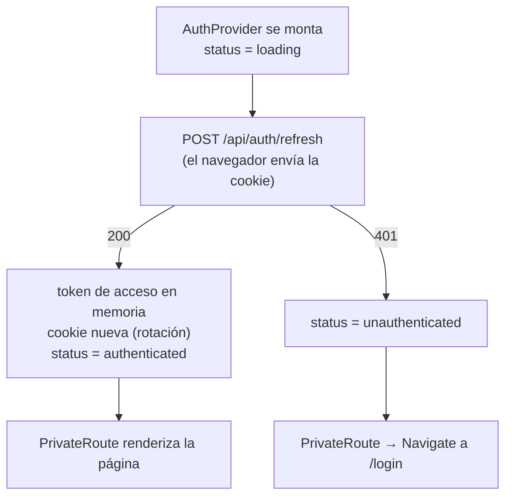
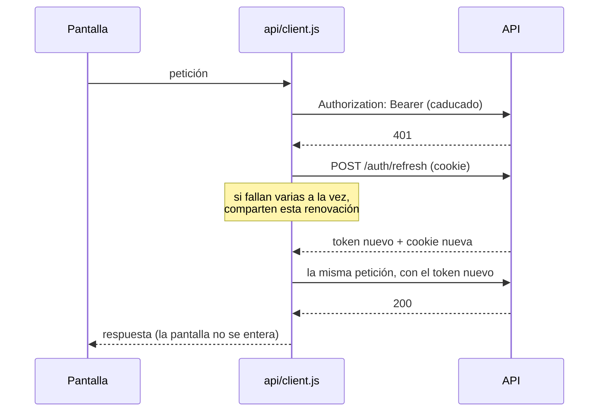
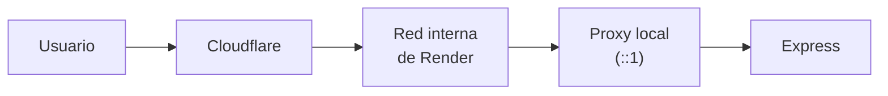

# Autenticación

[← Índice](README.md)

Dos tokens desde el bloque 11 ([0037](../DECISIONS.md), sustituye a la 0008):

- **Token de acceso:** JWT con `{ userId }`, **15 minutos**. El cliente lo guarda **solo en
  memoria** (`api/client.js`) y lo envía en cada petición (`Authorization: Bearer`).
- **Token de renovación:** valor aleatorio de 256 bits, **30 días**, en una **cookie httpOnly**
  (`yieldfit_renovacion`) que JavaScript no puede leer. Sirve para pedir un token de acceso nuevo
  sin contraseña. En la base solo se guarda su huella (SHA-256), con índice TTL. Cada uno sirve
  una vez (rotación).

| Pieza | Archivo | Qué hace |
|---|---|---|
| Token de acceso | `server/utils/jwt.js` | `signToken(userId)` (15 min), `verifyToken(token)` con `JWT_SECRET` |
| Token de renovación | `server/utils/refreshToken.js`, `models/RefreshToken.js` | emitir, rotar (con margen de 30 s) y revocar |
| Endpoints | `server/controllers/authController.js` | `register`, `login`, `refresh`, `logout`, `me` |
| Proteger rutas | `server/middlewares/authMiddleware.js` | `requireAuth`: valida el token de acceso y carga `req.user` |
| Token en memoria y renovación | `client/src/api/client.js` | interceptores de axios; `renovarSesion` |
| Estado de sesión | `client/src/context/AuthContext.jsx` | `status`: `loading` → `authenticated` / `unauthenticated` |
| Rutas privadas | `client/src/components/PrivateRoute.jsx` | redirige a `/login` si no hay sesión |

## Registro

El usuario y sus ejercicios se crean en una **transacción**: o se guardan los dos, o ninguno
([0002](../DECISIONS.md)). El registro ya devuelve un token, así que el usuario queda logueado
sin pasar por `/login`.



## Login



El mensaje de error es **el mismo** para "email no existe" y "contraseña incorrecta", para no
revelar qué emails están registrados.

## Peticiones protegidas



`requireAuth` consulta la base de datos en cada petición. Tiene un coste, pero hace que un
usuario borrado deje de tener acceso aunque su token no haya caducado.

## Al abrir la app

El token de acceso vive en memoria, así que al recargar no existe: se pide uno con la cookie.



Mientras `status = loading`, `PrivateRoute` muestra "Cargando...". Si el servidor estaba dormido
(arranque en frío de Render), debajo aparece el aviso "Despertando el servidor…"; ver
[arquitectura.md](arquitectura.md#arranque-en-frío-de-render).

La intro de bienvenida se decide antes de saber si la sesión vale, con un indicador sin datos en
localStorage (`yieldfit_con_sesion`, `utils/indicadorSesion.js`).

## Cuando el token de acceso caduca



Si la renovación falla (cookie caducada, revocada o robada) o la petición repetida vuelve a dar
401, la sesión ha caducado de verdad: `api/client.js` lo anuncia, `AuthContext` cierra la sesión y
`PrivateRoute` lleva a `/login` sin recargar. Un 401 **sin** token (contraseña incorrecta en el
login) no es una sesión caducada.

**Rotación y margen de gracia:** cada token de renovación sirve una vez. Si dos pestañas renuevan
casi a la vez con el mismo, la segunda se acepta dentro de 30 s. Un token gastado hace más tiempo
que vuelve a aparecer se trata como robado: se borra toda su familia (los tokens de ese inicio de
sesión) y hay que volver a entrar.

## Cerrar sesión

`POST /api/auth/logout` invalida el token de renovación de este dispositivo (y su familia) y borra
la cookie; el cliente olvida el token de acceso. Si la petición falla (sin conexión), se sale
igualmente en el cliente. Los demás dispositivos del usuario siguen dentro.

## Limitaciones conocidas

- Un token de acceso robado vale hasta 15 minutos: no se puede revocar uno a uno (no se
  consulta ninguna lista en cada petición).
- La cookie de renovación funciona porque la app y la API son el mismo sitio (`yieldfit.app`).
  En la app de iPhone (bloque 12) no habrá cookie de ese sitio: el token de renovación irá en el
  almacenamiento seguro del sistema.
- El límite de intentos es por IP y email: un ataque repartido entre muchas IP no se frena así.
  Los contadores están en memoria y se ponen a cero si Render reinicia el servidor.
- La IP depende de cuántos proxies tiene Render delante (3 hoy); ver
  [La IP real detrás de Render](#la-ip-real-detrás-de-render).

## Límite de intentos

Desde el bloque 11 ([0035](../DECISIONS.md)), `middlewares/limiteIntentos.js`:

| Ruta | Límite | Qué cuenta |
|---|---|---|
| `POST /api/auth/login` | 5 cada 15 min por IP + email | solo los fallos (un acierto no suma) |
| `POST /api/auth/register` | 5 por hora por IP | cada registro |

Al pasarse, el servidor responde **429** con "Demasiados intentos… Vuelve a intentarlo en N
minutos", que el formulario muestra tal cual.

### La IP real detrás de Render

El límite depende de `req.ip`. Entre el usuario y Express hay **tres proxies**, y cada uno añade
al final de la cabecera `X-Forwarded-For` la IP que ve ([0038](../DECISIONS.md)):



Lo que llega a Express es `X-Forwarded-For: [lo que mande el cliente…], usuario, Cloudflare, Render`,
y la conexión viene del proxy local. Con **`trust proxy` a 3** (`TRUST_PROXY`, por defecto 3),
Express cuenta tres saltos desde el final y se queda con el siguiente: la IP del usuario. Lo que
un cliente escriba en `X-Forwarded-For` queda por delante y se ignora.

**Si Render cambia la cadena,** la cuenta deja de cuadrar: con un proxy más, `req.ip` sería una IP
de Cloudflare (límites compartidos por todos); con uno menos, sería lo que mande el cliente. Se
comprueba en los logs de Render (morgan escribe `req.ip` en cada petición: tiene que ser la IP
real) y con esta prueba, que debe devolver la IP real y no `1.2.3.4` en los logs:

```bash
curl -s -H "X-Forwarded-For: 1.2.3.4" https://api.yieldfit.app/api/health
```

Se corrige cambiando `TRUST_PROXY` en Render, sin tocar código.

**Mismo tiempo exista o no el email:** si el email no existe, el login compara la contraseña
contra un hash falso con el mismo coste. Antes respondía antes (se saltaba bcrypt) y, midiendo
el tiempo, se podía saber qué emails están registrados.
