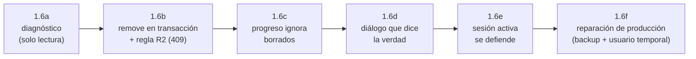

# Bloque 1 — Saneamiento

[← Índice](../README.md)

Estado: cerrado (2026-11-22)

## Objetivo

Dejar el proyecto sano antes de añadir funciones: que no pierda datos, que desarrollo no pueda
tocar producción, que producción tenga backups y que el código y la documentación digan la verdad.

## Qué se ha hecho

| Paso | Qué | Commits |
|---|---|---|
| 1.1 | Variables obligatorias sin valores por defecto: `CLIENT_ORIGINS` y `VITE_API_URL` | `b867f51` |
| 1.2 | Cierre ordenado del servidor al recibir SIGTERM (Render lo envía en cada deploy) | `ce90570` |
| 1.3 | Base de desarrollo `yieldfit-dev` separada de producción, con seed determinista | `12dc4ec`, `f41e460` |
| 1.4 | Errores 500 sin detalle interno en producción | `2847cf2` |
| 1.5 | Backups de producción con `mongodump` y prueba de restauración | `842818b`, `57e71b7` |
| 1.6 | Borrar un ejercicio conserva el historial (sustituye a la cascada `$pull`) y reparación de producción | `df610db` … `77aa467` |
| — | Eliminado `PUT /api/sessions/:id`, que reescribía los snapshots | `539aa45` |
| — | Atribución de Dither y DarkVeil (React Bits) y `THIRD_PARTY_NOTICES.md` | `558c73b` |
| — | Proyecto sin licencia (todos los derechos reservados) | `eb8f23c` |
| — | Comentarios obsoletos y falsos corregidos; CSS muerto de DarkVeil eliminado | `f9de5bf`, `842724e` |
| — | Hook que pide confirmación para git dentro de cualquier comando | `749eea2`, `1f39df2`, `53fefb7` |
| — | README raíz completo y README de `client/` | (cierre) |

### 1.6 en detalle: borrar un ejercicio

El paso más grande del bloque. La cascada antigua (0005) borraba el ejercicio de todo el
historial, dejaba sesiones vacías y rutinas rotas. Ahora (0020):

En producción se borraron 3 sesiones vacías y se limpiaron 2 rutinas rotas; el diagnóstico
posterior salió a 0. Detalle técnico en [modelo-datos.md](../modelo-datos.md#borrar-un-ejercicio-el-historial-se-conserva)
y procedimiento en [operaciones.md](../operaciones.md#reparaciones-puntuales-de-producción).

## Decisiones del bloque

| # | Decisión |
|---|---|
| 0017 | Base de datos de desarrollo separada de producción |
| 0018 | Backups manuales de producción con `mongodump` |
| 0019 | Backups solo en el portátil y riesgos aceptados |
| 0020 | Borrar un ejercicio conserva el historial (**sustituye a 0005**) |
| 0021 | Atribución del código de React Bits |
| 0022 | Repositorio público sin licencia |
| 0023 | Hook que pide confirmación para git dentro de cualquier comando |

## Qué cambió por el camino

- **Borrado de ejercicios:** el plan inicial incluía "archivar y restaurar". Se descartó frente a
  la opción B, que conserva el historial con menos código gracias a los snapshots (0020).
- **Backups:** `mongodump` imprimía la URI con la contraseña al fallar. Hubo que rotar la
  contraseña, pasar la URI por `--config` y filtrar toda la salida de los scripts.
- **Licencia:** ni MIT (lo que decía el badge) ni ISC (lo que decía `package.json`): sin licencia,
  para que nadie pueda publicar el proyecto como app propia (0022).
- **Git con confirmación:** dos comandos de git se ejecutaron sin confirmar (`git stash`, y
  `git rm` dentro de un heredoc). Primero se añadieron reglas `ask` y después un hook que lee el
  texto completo del comando (0023).

## Deuda detectada durante el bloque

Registrada en CLAUDE.md para los bloques que la tocan:

- `Dither.jsx`: el `useFrame` solo avanza el tiempo; sus props no reaccionan tras montar
  (bloque 12).
- La regla de "progreso sin ejercicios borrados" vive en el cliente hasta el bloque 4.

## Pendiente de David

- Prueba en vivo del hook de git al abrir de nuevo Claude Code (la positiva se rechaza).
