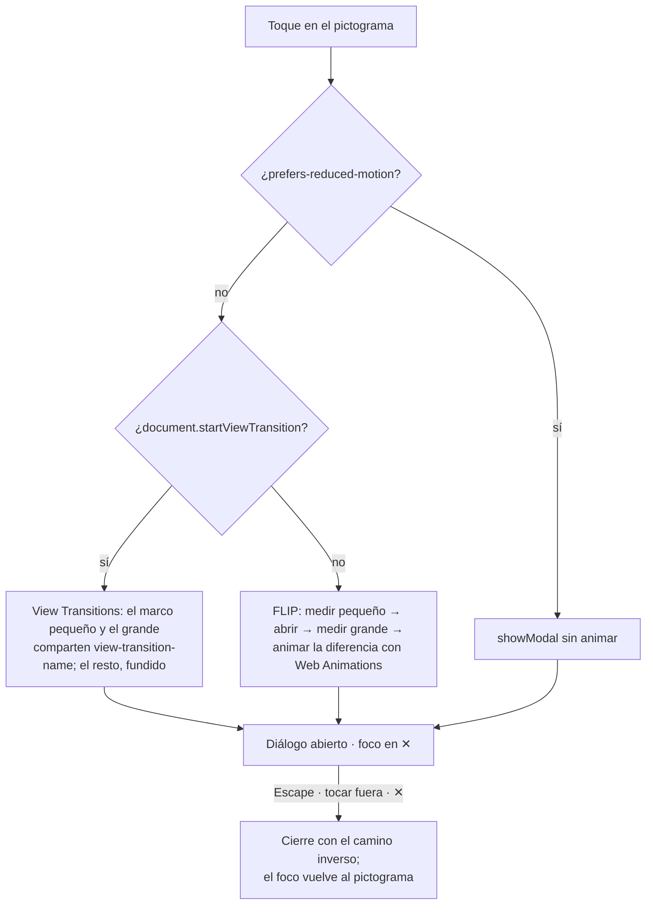

# Bloque 10 — Pictogramas de ejercicios y rutinas

[← Índice](../README.md)

Estado: en curso

## Objetivo

Que cada ejercicio y cada rutina se reconozcan de un vistazo con una figura propia (diseño
aprobado en el lienzo "Imágenes de ejercicios" y en la tarjeta Pictograma del design system).

## Qué se ha hecho

| Paso | Qué | Commits |
|---|---|---|
| 1 | Datos en `compartido/` y componente `Pictograma` | `3be8a77` `25668fc` |
| 2 | `presetId` en los ejercicios, snapshot del pictograma en las sesiones y migración | `b3dd8f4` `6e09793` `9e89c8a` |
| 3 | Icono de rutina: campo validado por el servidor y selector en el formulario | `421ec90` `33388f9` |
| 4 | Pictogramas en las pantallas y `presetId` en la sesión activa | `81eb4d6` `2519b75` `e9509d2` `d845530` |
| 5 | Vista ampliada | `02c09b7` |
| 6 | Revisión de diseño: regla de dos familias y Miniatura | pendiente |

## Migración de producción (paso 2)

`npm run migrar:preset`, aplicada el 2026-11-27 con el procedimiento de
[operaciones.md](../operaciones.md#reparaciones-puntuales-de-producción) (backup, prueba de
restauración y usuario temporal; la limpieza está hecha).

- **582** ejercicios actualizados, **0** pendientes en la comprobación.
- **20** no se reconocen (renombrados, con otro grupo o creados por el usuario): se quedan con la
  figura de su grupo, como se decidió.
- Las sesiones no se migran: las anteriores al bloque 10 muestran el marco vacío.

## Icono de rutina (paso 3)

`Workout.icono` guarda la **clave** (`empuje`), no el id de la figura, para poder cambiar el
dibujo sin migrar rutinas. El enum son las claves de `ICONOS_RUTINA` (`compartido/`), la misma
lista que pinta el selector, así que no hay copia en el cliente. `null` o `''` lo quitan; sin el
campo en la petición, no cambia. Prueba: `server/models/Workout.test.js`.

## Dónde se ven (paso 4)

| Pantalla | Tamaño | Qué figura |
|---|---|---|
| Lista y buscador de ejercicios | 40, zona de 48 | preset → grupo |
| Sesión activa | 48, zona de 48 | preset → grupo (`presetId` guardado en la sesión local) |
| Detalle de sesión | 32 | la del snapshot; sesión antigua → marco vacío |
| Lista de rutinas | 48 | el icono; sin icono → recuadro discontinuo con la mancuerna (`IconoRutina`). Sustituye a la insignia de iniciales |

En las filas, el pictograma es **hermano** del botón de la fila, no va dentro
(`PictogramaEjercicio`): en el paso 5 será su propio botón. En el buscador, el fondo de elegido
pasa del botón a la fila para cubrir también la figura.

Con el pictograma, la lista de ejercicios a 375 px dejaba los nombres de cardio en "Bi…". En el
móvil, el tipo pasa a la línea gris bajo el nombre ("Cardio · Cardio", como en el diseño) y la
columna "Tipo" solo se ve desde 600 px (`NombreEjercicio` acepta `claseTipo`). Si el grupo y el tipo
coinciden ("Cardio · Cardio"), se muestran una sola vez.

La mancuerna es un icono del design system (`rutina.svg` en el grupo Icons, versión 53). En la app,
los iconos propios salen de `BotonIcono` a un componente `Icono` (`components/Icono/`), que usan
`BotonIcono` y `IconoRutina`.

De paso: el detalle de sesión tenía su propia copia de `formatDuracion`, sin el arreglo del 7b, y
las sesiones de Strong sin duración salían como "NaNh NaN min". Se borró la copia y usa la de
`utils/formato.js`.

## Vista ampliada (paso 5)

Tocar el pictograma (no la fila) en la lista y el buscador de ejercicios o en la sesión activa
abre un `<dialog>` con la figura grande, el nombre y los chips de grupo y tipo. La animación vive
en `hooks/useVistaAmpliada.js`:

- 280 px en el móvil (sin pasarse del ancho) y 240 en escritorio: `Pictograma` acepta el tamaño
  como valor CSS (`var(--tam-ampliado)`).
- El diálogo va en un portal a `<body>` para no heredar estilos de la fila.
- Probado en Chrome y en WebKit 27.2 (Playwright 1.65.0) a 375 y 1280 px: los dos tienen View
  Transitions, y el grupo vuela de 40 px en la fila a 280 px en el centro en 280 ms. Escape, tocar
  fuera y ✕ cierran; tocar dentro no; el foco vuelve; con movimiento reducido no anima; la fila
  sigue abriendo o eligiendo.
- Fase 2, solo apuntada: animar el movimiento con una segunda postura por figura.

## Revisión de diseño (paso 6)

Tras ver las pantallas, David pidió una revisión: había dos mancuernas distintas en la misma
pantalla (el menú y la rutina sin icono), el recuadro discontinuo parecía un error y los
pictogramas e iconos de línea convivían sin regla. Diseño aprobado en la tarjeta **Miniatura** del
design system (versiones 54 y 55):

- **Dos familias:** iconos de interfaz (línea 1,5, `currentColor`; navegan y actúan) y
  pictogramas (contenido; siempre en una Miniatura). Nunca se mezclan en la misma Miniatura; en una
  fila, la Miniatura al principio y las acciones al final. La mancuerna es solo "Entrenar": se
  retira `rutina.svg`. Todos los iconos propios viven en `components/Icono/`, también los del
  menú (`NavItems` solo nombra el icono).
- **Miniatura** (sustituye a `Pictograma`): tamaños 32, 40, 48 y ampliada; radio `radius-sm`
  siempre, por la regla concéntrica (24 − 16 = 8); figura al 90 %. Donde toca la esquina de su
  tarjeta, la tarjeta lleva `space-md` de relleno (rutinas: 80 px de alto); en listas y buscador
  queda a `space-md` del borde. El selector baja de 64 a 48.
- **Estado vacío:** la Miniatura con el icono "Entrenar" en gris, al 50 %, para la rutina sin icono
  y para el ejercicio de una sesión anterior al bloque 10. El borde discontinuo, solo en "Sin
  icono" del selector.
- **Foco:** al abrir la vista ampliada, el foco va al diálogo (`tabindex="-1"`) y no a la ✕; el
  anillo solo con `:focus-visible`.
- La papelera de la lista de ejercicios pasa a trazo 1,5 a 20 px.

## Deuda vista en este bloque

- `--font-size-md` se usa en cuatro secciones de la portada (`pages/Welcome/sections/`) pero no
  existe en `variables.css`: esos textos heredan el tamaño del contenedor.
- Copias de funciones de formato en las páginas (pendiente de decidir): `formatFecha` en History,
  SessionDetail y Profile; `formatFecha` en UsuariosAdmin y `formatFechaHora` en ReportesAdmin;
  `fechaCorta` en WidgetRecordEjercicio y `fecha` en WidgetFrecuencia y WidgetRacha.
- El estilo de 12 px del design system (0,75rem) no tiene variable y aparece suelto en 9 sitios
  y en `SelectorIcono`.
