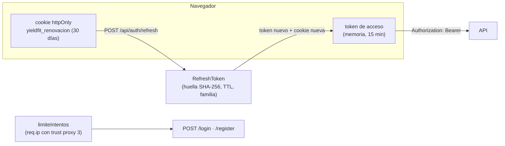

# Bloque 11 — Auth robusta

[← Índice](../README.md)

Estado: cerrado (2026-11-23)

## Objetivo

Que robar o adivinar el acceso a una cuenta cueste de verdad: limitar los intentos de login y
registro, y cambiar el token de 7 días en `localStorage` por uno de acceso corto en memoria más uno
de renovación que JavaScript no puede leer y que se puede revocar.

## Qué se ha hecho

| Paso | Qué | Commit |
|---|---|---|
| 11.1 | Límite de intentos en login y registro, login en tiempo constante (`limiteIntentos.js`) | `d811291` |
| — | API en `api.yieldfit.app` (mismo sitio que la app, para la cookie) | `3dc1fc7` |
| 11.2 | Servidor: token de acceso de 15 min, renovación con cookie, rotación por familia (`RefreshToken`) | `0f4629f` |
| 11.3 | Cliente: token en memoria, renovar al abrir y ante un 401, logout en el servidor | `6b0ed46`, `95ee885` |
| 11.4 | IP real detrás de Render: diagnóstico temporal, `trust proxy` a 3, diagnóstico retirado | `188b9af`, `d6d501b`, `1d0f53f` |

El 11.1 se hizo antes del bloque 9b, por prioridad.

El detalle de cada flujo está en [auth.md](../auth.md).

## Pruebas

- **Local:** login, recarga sin perder la sesión, renovación con `DURACION_ACCESO_PRUEBA=20s`
  (la pantalla no se entera), dos pestañas a la vez, logout, y los 429 del límite.
- **Producción:** login y sesión tras recargar; `req.ip` igual a la IP real aunque se envíe un
  `X-Forwarded-For` falso, y la IP real en los logs de Render.

No hay pruebas automáticas de este bloque: casi todo es comportamiento de red y cookies.

## Decisiones del bloque

| # | Decisión |
|---|---|
| 0035 | Límite de intentos en el login y el registro |
| 0037 | Token de acceso de 15 minutos en memoria y token de renovación en cookie httpOnly (sustituye a 0008) |
| 0038 | La IP real detrás de Render: `trust proxy` a 3 (corrige el valor de la 0035) |

## Qué cambió por el camino

- **La API cambió de dominio** (`api.yieldfit.app`): sin eso, Safari habría bloqueado la cookie
  de renovación por ser de otro sitio.
- **`trust proxy` a 1 no bastaba:** los logs mostraban una IP interna de Render para todos, así
  que el límite de registro era global. En lugar de suponer cuántos proxies había, se midió con un
  endpoint temporal y se retiró al comprobar el arreglo (0038).
- **BREACH revisado** (pendiente desde la 0028): sigue sin aplicar con la cookie `SameSite=Lax`.
- **Sin cerrar en este bloque:** la app de iPhone necesitará el token de renovación en el
  almacenamiento seguro nativo (bloque 12).
