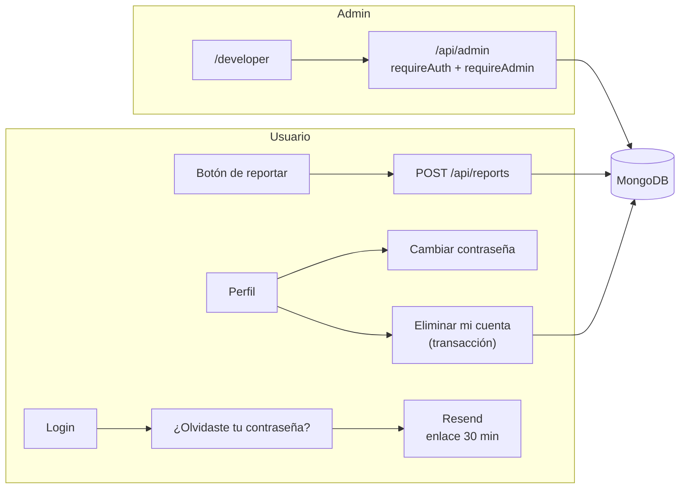

# Bloque 11b — Beta cerrada

[← Índice](../README.md)

Estado: cerrado (2026-11-24)

## Objetivo

Lo necesario para pasar la app a conocidos: saber quién la usa y qué falla, que cada uno pueda
gestionar su cuenta (contraseña, recuperarla, borrarla) y explicar con claridad qué datos se
guardan.

## Qué se ha hecho

| Paso | Qué | Commits |
|---|---|---|
| 11b.1 | Rol de admin (`npm run admin`), `requireAdmin` y último acceso | `04bca86`, `b2c722a` |
| 11b.2 | Reportar fallos: `BugReport`, `POST /api/reports` y botón flotante | `6b0a15c`, `9b8859d`, `8dd2b54` |
| 11b.3 | Página `/developer`: reportes y usuarios (`/api/admin`) | `20d10be`, `90eab85` |
| 11b.4 | Borrar la cuenta con todos sus datos | `af189ea`, `4b9657b` |
| 11b.5 | Cerrar sesión borra el dispositivo; cambiar la contraseña; script de restablecer | `ed45426`, `3c3ee04`, `aebf69b`, `23493b2` |
| 11b.5b | Recuperar la contraseña por email (Resend) | `0510854`, `b9e25e5`, `68c86b5`, `044da88` |
| 11b.6 | Rotación de backups y nota de privacidad | `05a8e6a`, `9c01518` |
| 11b.7 | Data router y aviso de cambios sin guardar; botones que se apilan | `c9ef208`, `019d22e`, `454f9ba` |

## Pruebas

- **Automáticas** (sin base de datos): `node utils/borrarCuenta.test.js` y
  `bash scripts/lib/rotacion.test.sh` desde `server/`; `node src/utils/cambios.test.js` y
  `node src/utils/filtroFechas.test.js` desde `client/`.
- **Contra `yieldfit-dev`** con usuarios desechables (creados y borrados en el mismo script):
  borrado de cuenta y flujo de recuperación en modo consola.
- **Medidas de diseño** con Chrome sin ventana a 375, 390 y 1280 px.
- **Producción:** recuperación por email (SPF, DKIM y DMARC en PASS, en bandeja de entrada).

## Decisiones del bloque

| # | Decisión |
|---|---|
| 0039 | Los backups se rotan: se conservan los 3 últimos |
| 0040 | Rol de admin asignado por script y página `/developer` |
| 0041 | Reportes de fallos desde un botón flotante |
| 0042 | Borrar la cuenta con todos sus datos, y el dispositivo al cerrar sesión |
| 0043 | Contraseña: cambiarla, restablecerla por script y recuperarla por email con Resend |
| 0044 | Nota de privacidad informativa, pública y sin email de contacto |
| 0045 | Data router y aviso de cambios sin guardar |
| 0046 | Filas de botones que se apilan (`GrupoBotones`) y responsive obligatorio |

## Qué cambió por el camino

- **Recuperación por email adelantada a la beta** (estaba prevista para después); el script de
  restablecer queda como plan B.
- **Backups rotados** para que la nota de privacidad pudiera prometer un plazo; sacarlos del
  portátil queda en la deuda.
- **El paso 11b.7 apareció al probar** (los formularios perdían los cambios sin avisar), y con él
  el arreglo de los botones que desbordaban en el móvil.
- **Sin códigos de invitación:** basta con no difundir el enlace.
