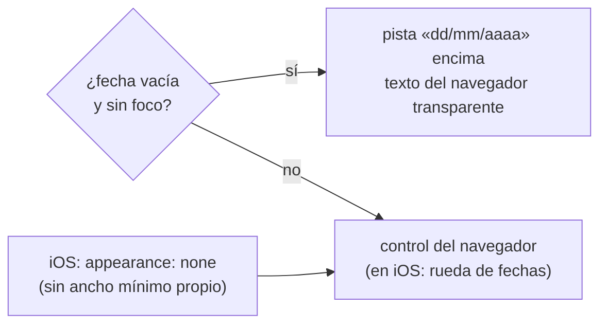

# Bloque 11c — Registro en iOS

[← Índice](../README.md)

Estado: cerrado (2026-11-24)

## Objetivo

Arreglar con urgencia el registro en el iPhone, ya con la beta abierta: el campo de fecha se
salía por la derecha y, vacío, no mostraba nada.

## Qué se ha hecho

| Paso | Qué | Commits |
|---|---|---|
| 1 | Campos de fecha sin aspecto nativo en iOS; los filtros de `/developer` pasan a `Input` | `bfcbe0b` |
| 2 | Pista "dd/mm/aaaa" en los campos de fecha vacíos | `5242f78` |
| 3 | Registro: placeholders "Ej.", teclados numéricos y autocompletado | `86474a9` |

## Pruebas

- Chrome de escritorio a 375, 390, 1024 y 1280 px: sin desbordes, todos los campos a 16 px (sin
  zoom al enfocar en iOS), pista visible solo con la fecha vacía y sin foco, atributos de teclado
  y autocompletado.
- **iPhone de David, en Chrome y Safari:** correcto. El portátil no tiene simulador de iOS, así
  que esta es la prueba que cuenta para los campos de fecha.

## Decisiones del bloque

| # | Decisión |
|---|---|
| 0053 | Campos de fecha sin aspecto nativo en iOS y con pista propia |

## Qué cambió por el camino

- **Las medidas con Chrome de escritorio no detectaban el fallo**: la emulación no reproduce cómo
  pinta iOS los campos de fecha. Queda anotado en la 0053.
