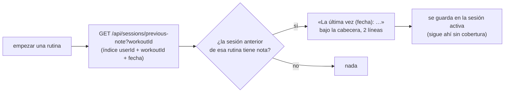

# Bloque 11d — Feedback de la beta

[← Índice](../README.md)

Estado: cerrado (2026-11-25)

## Objetivo

Atender los primeros reportes reales de la beta (página `/developer`): tres fallos de pantalla,
una mejora y dos funciones nuevas. Decisión: [0055](../../DECISIONS.md).

## Qué se ha hecho

| Paso | Qué | Commits |
|---|---|---|
| 1 | La hoja de "Reportar un fallo" se ve por encima de todo (portal) | `080d0a9` |
| 2 | El aviso de servidor dormido cabe en el móvil | `ab9c21d` |
| 3 | La barra del descanso se ve en el iPhone (fuera de la fila, con `scaleX`) | `d3b159f` |
| 4 | Cronómetro con horas, minutos y segundos ("1:30:05") | `af35e29` |
| 5 | Añadir ejercicios a la sesión en curso, y dos arreglos que salieron al probarlo | `8be3584` `76d38a6` `1f63f06` |
| 6 | Notas de la sesión y "la última vez" | `84f3403` `7cdee50` `c7c81eb` `4b4cab4` `166043e` `c658ec5` |

El punto 7 del reporte (nombres largos cortados) se descartó.

## Cómo funciona "la última vez"

## Pruebas

- Servidor: notas (recortadas, vacías, 501 caracteres, no texto), "la última vez" (otra rutina,
  otro usuario, sesión anterior sin nota) y `explain` del índice nuevo.
- Chrome a 375, 390 y 1280 px: añadir varios ejercicios, serie anterior de los añadidos, notas que
  sobreviven a recargar, detalle e icono en el Historial.
- **iPhone de David, en producción:** la hoja de reportar, el aviso de servidor dormido, la barra
  del descanso y el cronómetro, correctos. El portátil no tiene simulador de iOS.

## Decisiones del bloque

| # | Decisión |
|---|---|
| 0055 | Notas de la sesión con "la última vez", y añadir ejercicios a una sesión en curso |

## Qué cambió por el camino

- **El círculo de "Reportar" tapaba el botón del buscador** de reemplazar y añadir, y "Reemplazar
  ejercicio" se partía en dos líneas: arreglados en sus propios commits.
- **La nota de la última vez iba junto al cronómetro**, en una columna estrecha: pasó a todo el
  ancho bajo la cabecera, recortada a 2 líneas y entera al tocarla.
