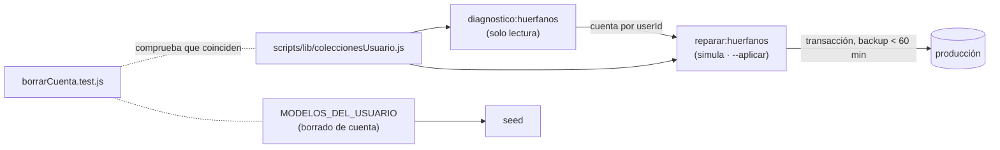

# Bloque 1c — Dependencias del cliente y datos huérfanos

[← Índice](../README.md)

Estado: cerrado (2026-11-24)

## Objetivo

Dejar el cliente sin vulnerabilidades conocidas y limpiar los datos de usuarios que ya no
existen (en producción, de 4 usuarios borrados a mano), sin que vuelvan a aparecer.

## Qué se ha hecho

| Paso | Qué | Commits |
|---|---|---|
| 0 | Orden de trabajo en el roadmap | `020c71f` |
| 1 | `npm audit fix` en el cliente (sin `--force`) | `c96555e` |
| 2 | `diagnostico:huerfanos` y `reparar:huerfanos`, lista única de colecciones del usuario | `c33e5a8` |
| 3 | El seed vacía todas las colecciones del usuario | `50ac83d` |
| — | Deuda actualizada | `4481a07` |
| — | Limpieza en producción (David, procedimiento de reparaciones) | — |

## Cómo funciona

- El diagnóstico agrupa cada colección por `userId` y compara con los `_id` de `users`. Lo que
  no coincide es huérfano. Los documentos sin `userId` se cuentan aparte y no se tocan.
- La reparación repite el cálculo dentro de una transacción, borra con `$in`, comprueba que lo
  borrado coincide con lo contado y que no queda nada. Para si encuentra más de 10 usuarios
  huérfanos (sería un fallo del cálculo, no una limpieza).
- Procedimiento y comandos: [operaciones.md](../operaciones.md).

## Pruebas

- Base de desarrollo (`-- --desarrollo`): diagnóstico, simulación y limpieza, probados por David.
- `node utils/borrarCuenta.test.js` desde `server/`: la lista de los scripts coincide con
  `MODELOS_DEL_USUARIO`.
- `npm audit` en el cliente: 0 vulnerabilidades.
- Producción: limpieza hecha por David con el procedimiento de reparaciones. Había datos de
  4 usuarios inexistentes: se borraron 230 ejercicios, 2 rutinas y 5 sesiones huérfanas, y el
  diagnóstico posterior dio 0.

## Decisiones del bloque

| # | Decisión |
|---|---|
| 0050 | Datos huérfanos: diagnóstico y limpieza por script, y seed que vacía todo lo del usuario |

## Qué cambió por el camino

- **El seed también creaba huérfanos** en desarrollo (solo vaciaba 5 colecciones): se corrigió
  en su propio commit.
