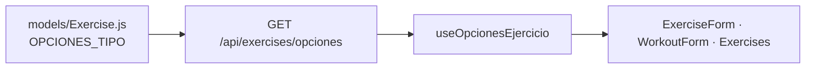

# Bloque 2 — Máquina de discos

[← Índice](../README.md)

Estado: cerrado (2026-11-22)

## Objetivo

Añadir el tipo de ejercicio "Máquinas de discos" (máquinas que se cargan con discos, como las
Hammer Strength) y, antes, resolver la deuda que lo hacía costoso: las listas de grupos y tipos
estaban copiadas a mano en el cliente.

## Qué se ha hecho

| Paso | Qué |
|---|---|
| 2.1 | El modelo define grupos y tipos como `{ value, label }` y `GET /api/exercises/opciones` los devuelve |
| 2.2 | El cliente los pide con `useOpcionesEjercicio`; desaparecen las tres copias a mano |
| 2.3 | Tipo nuevo `Maquinas de discos` ("Máquinas de discos"): una línea en el servidor, cero en el cliente |

Detalle en [modelo-datos.md](../modelo-datos.md#exercise).

## Usuarios existentes

- **Sin migración.** Añadir un valor al enum no invalida ningún documento.
- **Tracking:** los ejercicios de máquina de discos se miden por 1RM (solo Cardio + Cardio va por
  tiempo y distancia).
- **Historial:** las sesiones guardan nombre y tracking, no el tipo; reclasificar un ejercicio no
  cambia ninguna sesión.
- **Presets:** no se ha reclasificado ninguno. Quien quiera, edita el tipo de su ejercicio.

## Decisiones del bloque

| # | Decisión |
|---|---|
| 0024 | Grupos musculares y tipos: el servidor es la única fuente |

## Qué cambió por el camino

- Al quitar las copias aparecieron dos bugs que ya existían: los filtros de la lista de
  ejercicios nunca funcionaban (`'pecho'` frente a `'Pecho'`) y la columna Tipo mostraba
  "Maquinas" sin tilde. Ambos se corrigen con las listas del servidor.
