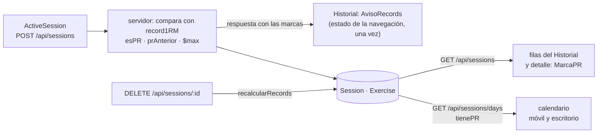

# Bloque 4b — Récords personales

[← Índice](../README.md)

Estado: cerrado (2026-11-24)

## Objetivo

Marcar los récords personales (PR) en el Historial, el detalle de la sesión y el calendario, y
avisar al terminar el entreno, con un cálculo en el servidor que no crezca con el historial.

**Récord:** el mejor 1RM estimado de un ejercicio en la sesión supera estrictamente el de todas
sus sesiones anteriores. La primera vez solo fija la marca, igualar no cuenta y el cardio nunca.

## Qué se ha hecho

| Paso | Qué | Commits |
|---|---|---|
| 1 | Récords al guardar: `esPR`, `prAnterior` y `Exercise.record1RM` (`utils/records.js`, con pruebas) | `84b23a0` |
| 2 | Borrar una sesión recalcula los récords de sus ejercicios | `8db6d3a` |
| 3 | Script `migrar:pr` y récords en el seed | `de76f93`, `d4f2432` |
| 4 | `GET /api/sessions/days` con `tienePR` | `00833a3` |
| — | Modelo de datos y DECISIONS 0051 | `372a9e0` |
| 5 | Componente `MarcaPR` (también en el design system) y marcas en Historial y detalle | `0d5f95a` |
| 6 | Marcas en el calendario (móvil y escritorio) | `801721b` |
| 7 | Aviso de récords al terminar el entreno | `d874793` |
| 8 | Migración en producción (David) y cierre | — |

El cálculo y los casos de borrado y de fecha atrasada están en
[modelo-datos.md](../modelo-datos.md#récords-personales).

## Pruebas

- `node utils/records.test.js` desde `server/`: 19 casos del criterio (primera vez, empate,
  cardio, ejercicio repetido en la sesión, borrar el error de 500 kg, idempotencia).
- API contra la base de desarrollo con una cuenta desechable: 22 comprobaciones (guardar, el
  cliente no puede marcar récords, borrar el error y recuperar los récords posteriores, sesión
  con fecha atrasada, `tienePR`, 404).
- `migrar:pr` en desarrollo: 119 sesiones marcadas; una segunda pasada no cambia nada.
- `node src/utils/records.test.js` y `node src/utils/formato.test.js` desde `client/`.
- Interfaz a 375, 390, 1024 y 1280 px con una cuenta desechable: sin scroll horizontal ni marcas
  que se salgan o se partan; el aviso sin animación con "reducir movimiento" y una sola vez.
  Revisión de David en local.
- Producción (David, procedimiento de reparaciones): 2 sesiones actualizadas, 8 ejercicios con
  marca y la comprobación con 0 pendientes.

## Decisiones del bloque

| # | Decisión |
|---|---|
| 0051 | Récords personales marcados al guardar, con la marca de cada ejercicio como copia |

## Qué cambió por el camino

- **Calendario de escritorio:** la marca iba dentro de las píldoras de sesión y dejaba el nombre en
  "T…"; pasó junto al número del día.
- **Calendario móvil:** la marca tapaba la parte de arriba de los números; subió a la esquina.
- **Fila del Historial:** "Récord en …" no cabía junto a las cifras en el móvil; pasó a una fila
  propia a todo el ancho. El nombre de la sesión ahora se corta con puntos suspensivos.
- **Migración antes de la interfaz:** se ejecutó en producción al terminar el servidor (paso 4),
  sin esperar al paso 8, para que las sesiones nuevas no se tomaran como "primera vez".
