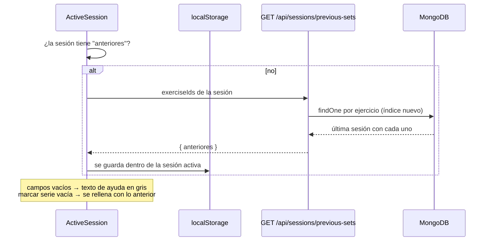

# Bloque 5 — Serie anterior

[← Índice](../README.md)

Estado: cerrado (2026-11-23)

## Objetivo

Ver en cada serie de la sesión activa lo que se hizo la vez anterior, para decidir el peso sin
salir del entreno, y poder repetirlo con un toque.

## Qué se ha hecho

| Paso | Qué | Commit |
|---|---|---|
| 5.1 | `GET /api/sessions/previous-sets` e índice `{ userId, ejercicios.exerciseId, fecha }` | `7d34755` |
| 5.2 | La sesión activa lo pide una vez y lo guarda en sí misma; texto de ayuda en los campos vacíos y atajo de repetir | `67918b3` |

## Mediciones

Seed de 10 años, documentos que examina MongoDB por ejercicio:

| Ejercicio | Con el índice nuevo | Solo con `{ userId, fecha }` |
|---|---|---|
| Hecho hace poco | 1 | 2 |
| No hecho nunca | 0 | 1.402 |

Una rutina de 4 ejercicios responde en ~110 ms (servidor local contra Atlas).

## Decisiones del bloque

| # | Decisión |
|---|---|
| 0028 | Sin middleware de compresión: Render ya comprime (paso previo al bloque) |
| 0029 | Serie anterior: última sesión con el ejercicio, guardada en la sesión activa |

## Qué cambió por el camino

- **Compresión:** se preparó el middleware `compression`, pero producción ya respondía con
  `content-encoding: br` (Render comprime con Brotli). Se descartó y se registró por qué (0028).
- **Cardio:** al revisar la sesión activa apareció que solo tiene campos de peso y reps. Queda
  como deuda en CLAUDE.md, con propuesta de bloque propio en el roadmap.

## Para el bloque 6

- Un ejercicio que se añada o reemplace a mitad de sesión no tendrá "anterior" hasta que se pida
  para él: el reemplazo tendrá que pedirlo.
