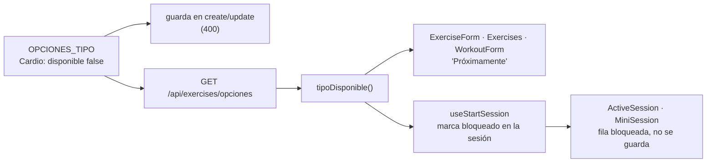

# Bloque 5b — Cardio bloqueado

[← Índice](../README.md)

Estado: cerrado (2026-11-23)

## Objetivo

La sesión activa no sabe registrar tiempo y distancia, así que el cardio se guardaba con peso y
reps a 0. Hasta implementarlo de verdad, se bloquea en la app con una etiqueta "Próximamente",
de forma que desbloquearlo sea cambiar una sola cosa en el servidor.

## Qué se ha hecho

| Paso | Qué | Commit |
|---|---|---|
| — | Diagnóstico de solo lectura `npm run diagnostico:cardio` | `ee9b4ae` |
| 5b.1 | `disponible: false` en la opción Cardio y guarda al crear o cambiar el tipo de un ejercicio | `34e5609` |
| 5b.2 | Etiqueta `Proximamente`, select con la opción deshabilitada, lista de ejercicios y rutinas | `8d4b1f0` |
| 5b.3 | Empezar sesión y sesión activa: la fila de cardio sale bloqueada y no se guarda | `7e44245` |

Para desbloquearlo: quitar `disponible: false` en `server/models/Exercise.js`.

## Diagnóstico de producción

66 ejercicios de cardio (los 6 predefinidos de cada usuario), 0 rutinas con cardio, 0 sesiones
con cardio: el bloqueo no afecta a datos existentes.

## Decisiones del bloque

| # | Decisión |
|---|---|
| 0030 | Cardio bloqueado con "Próximamente" desde las opciones del servidor |

## Qué cambió por el camino

- **La sesión guarda `bloqueado`, no el tipo:** las opciones se piden en cada carga de la app;
  sin cobertura, una sesión recargada no sabría qué filas bloquear.
- **Sin bloque para el cardio:** el análisis de cómo implementarlo queda en la deuda de
  `CLAUDE.md`, sin número en el roadmap.
- **Datos huérfanos:** el diagnóstico mostró ejercicios de 11 usuarios cuando solo existen 7.
  Registrado como deuda en `CLAUDE.md` (diagnóstico y limpieza pendientes).
