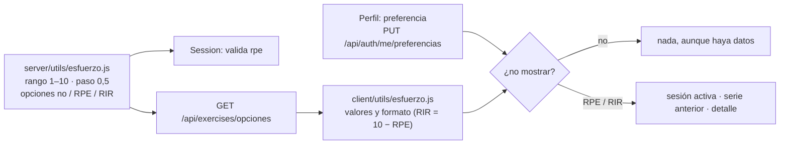

# Bloque 5c — Esfuerzo por serie (RPE/RIR)

[← Índice](../README.md)

Estado: cerrado (2026-11-26)

## Objetivo

Anotar el esfuerzo de cada serie, pensado para powerlifting, sin que estorbe a quien no lo usa.
Decisión: [0056](../../DECISIONS.md).

## Qué se ha hecho

| Paso | Qué | Commits |
|---|---|---|
| 1 | Diseño en el design system (tarjeta Esfuerzo, versiones 30 y 31) | — |
| 2 | Servidor: validación del RPE, preferencia del usuario y serie anterior con el RPE | `6f9e34b` `5bd0f64` `aa147c1` |
| 3 | Cliente: conversión y formato, preferencia en Perfil, `RadioGroup` sin texto partido | `c9d8c82` `de9d530` `b77c217` |
| 4 | Escala completa (1–10) y el esfuerzo en la sesión activa | `f0c1794` `7a6249b` `7070cec` `682faf1` |
| 5 | Columna de esfuerzo en el detalle de la sesión | `a60bab0` |
| 6 | Nota de privacidad y cierre | este commit y el anterior |

## Cómo funciona

- **Solo se guarda el RPE.** El RIR se calcula al mostrarlo.
- **El rango solo está en el servidor:** el cliente pinta los valores con el que recibe. Cambiar la
  escala de 6–10 a 1–10 no tocó ningún valor del cliente.
- **Sesión activa:** una pastilla bajo cada serie, fuera de la fila (con "no mostrar", la fila queda
  igual que antes y la barra del descanso sigue pegada a ella). Una sola abierta a la vez; al
  abrirse se desplaza para verse por encima de la barra de pestañas y de "Reportar".

## Pruebas

- Funciones puras: `server/utils/esfuerzo.test.js`, `client/src/utils/esfuerzo.test.js` y
  `activeSessionReducer.test.js` (el atajo de repetir no copia el RPE).
- Servidor contra la base de desarrollo: preferencia, validación (bordes, paso, no número), serie
  anterior y el 1RM sin cambios. Consulta de solo lectura: ningún `rpe` existente fuera del rango.
- Chrome a 375, 390 y 1280 px con tres cuentas (RPE, RIR, "no mostrar"): Perfil, sesión activa
  (valores de 52 × 44 px, el panel no tapa la serie siguiente, una sola abierta, Escape y tocar
  fuera) y detalle.
- **WebKit** (el motor de Safari en iOS, con Playwright fuera del repo), con toques: encontró dos
  fallos que Chrome no veía (ver abajo).

## Decisiones del bloque

| # | Decisión |
|---|---|
| 0056 | Esfuerzo por serie: se guarda solo el RPE, de 1 a 10, y se ve como RPE o RIR según el perfil |

## Qué cambió por el camino

- **La escala pasó de 6–10 a 1–10** a petición de David, con un commit propio del servidor.
- **WebKit encontró dos fallos:** con unos valores abiertos, tocar la pastilla de otra serie no abría
  ninguna (el panel se cerraba, todo subía y el toque caía fuera), y una serie de abajo dejaba los
  valores bajo la barra de pestañas. Arreglados antes del commit.
- **`RadioGroup` partía "No mostrar" en dos líneas** a 375 px: arreglado en el componente común.
- **"Peso total" del detalle se partía** a 375 px ("2000 / kg"), de antes del bloque: arreglado en
  su propio commit.
- **No había ninguna ruta para cambiar el perfil:** la preferencia tiene la suya, que solo acepta
  ese campo.
