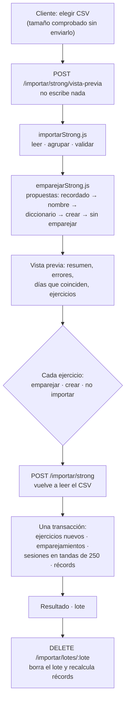

# Bloque 7b — Importar desde Strong

[← Índice](../README.md)

Estado: cerrado (2026-11-26)

## Objetivo

Traer a Yield Fit el historial exportado de Strong (CSV) sin duplicar nada, con años de historial
y dentro de los 512 MB de Render free. Decisión: [0057](../../DECISIONS.md). Durante el cierre
cambió también el botón primario ([0059](../../DECISIONS.md)).

## Qué se ha hecho

| Paso | Qué | Commits |
|---|---|---|
| 1 | Diseño en el design system (tarjeta Importar, versiones 32–34) | — |
| 2 | Lector del CSV: fechas de reloj a UTC (cambios de hora), agrupar, validar | `9b3075d` `cd27de7` `227aa26` |
| 3 | Modelos: `Session.importacion` y `EmparejamientoImport` | `78617c3` `4460759` `02b7877` |
| 4a | Propuestas de emparejamiento y compatibilidad fuerza/cardio | `cbbd663` `f77e26a` |
| 4b | Vista previa | `4d6bdf2` `35286a2` |
| 4c | Importar en una transacción | `7ad48cd` `34381c0` |
| 4d | Listar y deshacer lotes; memoria (tandas, una a la vez, 5 MB) | `4bc91e7` `6ee0f63` |
| 5 | Cliente: página de importar y botón del Historial | `b96e3db` `82f605f` `6d4d446` `b879772` `82b0950` `607411e` |
| 6 | "No importar" un ejercicio | `b22e518` `8a89f12` `b05f33c` `7351bba` `0a84b89` `1586fe6` `a2d35ac` |
| 7 | Botón primario de cristal y Reportar en pastilla | `1e4649d` `60ff414` |
| 8 | Nota de privacidad y cierre | este commit y el anterior |

## Cómo funciona

- **Fechas:** Strong exporta la hora de reloj sin zona; `fechaLocalAUtc` la pasa a UTC con la zona
  del dispositivo. Una hora que no existe (salto de marzo) se mueve a la siguiente; una que pasa
  dos veces (octubre) toma la primera.
- **Sin duplicados:** la clave es la fecha de inicio del CSV, con un índice único parcial.
- **Lo que se recuerda:** `EmparejamientoImport` guarda, por nombre de Strong, el ejercicio tuyo o
  `omitir: true`. Borrar el ejercicio borra su emparejamiento; deshacer una importación no.
- **Memoria:** el servidor solo hace una importación o un deshacer a la vez (503 si no), el CSV
  admite hasta 5 MB y las sesiones se guardan en tandas de 250 dentro de la misma transacción.
- **Lotes:** sus consultas filtran con `{ $eq: lote, $type: 'objectId' }` para usar el índice parcial.

## Pruebas

- Funciones puras: `zona`, `importarStrong`, `emparejarStrong`, `vistaPreviaStrong`,
  `construirImportacion`, `operacionPesada` (servidor), `EmparejamientoImport` (modelo) e
  `importar` (cliente). Ejemplo inventado en `server/scripts/fixtures/strong-ejemplo.csv`.
- Contra `yieldfit-dev`: índices con `explain`, duplicados y concurrencia, récords recalculados al
  importar y al deshacer, cascada de los emparejamientos.
- Medición: 5 años del seed y un CSV de 4,96 MB con el heap a 256 MB (ver 0057).
- Navegador: 375, 390, 1024 y 1280 px en Chrome, y WebKit (iPhone 13 emulado).

## Pendiente

- Backup de producción (`npm run backup`) antes de la primera importación de David.
