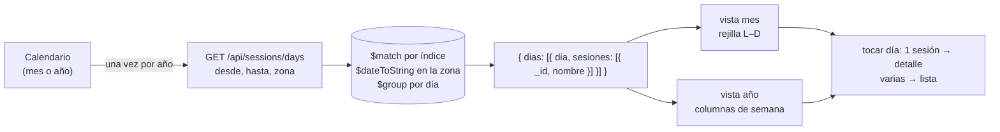

# Bloque 8 — Calendario de días entrenados

[← Índice](../README.md)

Estado: cerrado (2026-11-23)

## Objetivo

Ver de un vistazo qué días se ha entrenado, por meses y por años, sin descargar sesiones.

## Qué se ha hecho

| Paso | Qué | Commit |
|---|---|---|
| 8.1 | `GET /api/sessions/days`: días por rango, agrupados en la zona del usuario | `ac37c79` |
| 8.2 | Calendario mensual arriba del Historial (primera versión, plegable) | `a0b8dd7` |
| 8.3 | Siempre desplegado, vista de mes y de año tipo GitHub, celdas acotadas en escritorio | (cierre) |

## Detalles que importan

- **Zona horaria:** las fechas están en UTC y el servidor en Frankfurt. Agrupar en UTC pondría
  una sesión de las 00:30 en el día anterior; por eso el cliente envía su zona.
- **Índice:** la consulta solo necesita `userId` y `fecha`, que están en `{ userId, fecha }`:
  MongoDB responde sin abrir ninguna sesión (0 documentos examinados).
- **Pruebas:** `node src/utils/calendario.test.js` (desde `client/`), con meses que empiezan en
  domingo, febrero bisiesto, el mes del cambio de hora y el año en columnas de semana.

## Decisiones del bloque

| # | Decisión |
|---|---|
| 0033 | Calendario de días entrenados: mes y año, desde un endpoint de solo fechas |

## Qué cambió por el camino

- **Plegado → siempre visible**, y vista anual tipo GitHub añadida tras la primera prueba.
- **Tamaño fijo y diseño de la app:** vistas superpuestas (la tarjeta no salta), mes de 6 filas,
  celdas cuadradas con separación uniforme, círculos de cristal verde, cabecera y flechas como
  en el resto de la app.
- **Tokens nuevos:** `--color-accent-soft` y `--color-accent-medium` en `variables.css`; los
  verdes sueltos del resto de la app quedan como deuda en `CLAUDE.md`.
- **Celdas gigantes en escritorio:** la rejilla ocupaba todo el ancho; ahora cada celda mide
  como mucho 44 px.
- **Un año por petición:** con la vista anual, pedir por meses habría sido 12 peticiones; un año
  cabe en el límite de 366 días y la vista mensual lee de ahí.
