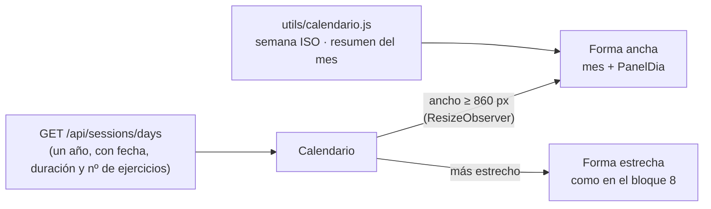

# Bloque 8b — Calendario en escritorio

[← Índice](../README.md)

Estado: cerrado (2026-11-24)

## Objetivo

Aprovechar el espacio del escritorio en el calendario del Historial (bloque 8): el mes a la
izquierda y un panel con el día seleccionado a la derecha, con el design system Premium. En el
móvil, como antes.

## Qué se ha hecho

| Paso | Qué | Commits |
|---|---|---|
| 1 | El endpoint de días añade hora, duración y número de ejercicios (sin series) | `82313e2` |
| 2 | Calendario en dos columnas: celdas altas con píldoras, panel del día, mes comparado con el anterior; hora y duración en la lista del móvil | `c2c6ed1` |
| 3 | Anchos de maqueta comunes para todas las páginas (`--ancho-pagina`, `--ancho-formulario`) | `53238cc` |
| 4 | Ajustes tras revisión: número del panel, título en el móvil; vista Año a todo el ancho (sin panel, casillas que llenan el ancho, tocar un día lleva a su mes) y tarjeta que encoge; verde del escritorio en el calendario del móvil | `0320a4e` y los siguientes |
| 5 | Radios de borde estandarizados y botones cuyo texto nunca se parte | (ver historial) |
| — | Documentación: DECISIONS 0049 y roadmap | `17710ab` |

## Pruebas

- `node src/utils/calendario.test.js` y `node src/utils/formato.test.js` desde `client/`
  (semana ISO con cambios de año, resumen del mes, formato de duración).
- Medidas y capturas con una cuenta desechable con sesiones de dos meses a 375, 390, 1024 y
  1280 px: sin desbordes; dos columnas solo cuando el calendario tiene sitio.

## Decisiones del bloque

| # | Decisión |
|---|---|
| 0049 | Calendario en dos columnas en escritorio, con panel del día |

## Qué cambió por el camino

- **El corte va por el ancho del calendario, no de la pantalla:** con la barra lateral, a 1024 px
  no hay sitio para dos columnas. Se mide la caja exterior: medir el contenido hacía que el
  calendario oscilara entre las dos formas.
- **Sin mapa de actividad ni barras de progreso:** la vista Año ya es un mapa, y sin objetivos una
  barra no mide nada; en su lugar, tres cifras del mes comparadas con el anterior.
- **Una maqueta común:** al ensanchar el calendario se vio que cada página tenía su propio ancho
  (600 a 1120 px). Ahora hay dos tokens y todas las páginas usan uno de ellos.
- **La lista del día en el móvil se leía mal** (el cristal dejaba ver el calendario): fondo sólido
  de nivel 2.
- **Revisión de diseño general:** las tarjetas mezclaban tres radios y había valores sueltos (todo
  pasa a los tokens del design system, con la regla en CLAUDE.md), y algunos botones partían su
  texto en el móvil ("Iniciar sesión" en la portada): ahora nunca se parte, con menos relleno en
  pantallas estrechas y `GrupoBotones` donde hay dos.
