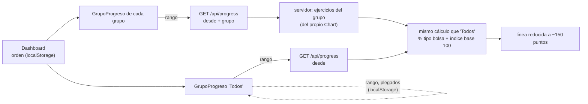

# Bloque 9 — Grupos de progreso

[← Índice](../README.md)

Estado: cerrado (2026-11-23)

## Objetivo

Además de "Todos", grupos propios de ejercicios con su progreso, y en cada uno: elegir el rango
(el % se mide desde el primer punto, como en bolsa), ocultar la lista de ejercicios, plegar la
tarjeta y ordenar las tarjetas.

## Qué se ha hecho

| Paso | Qué | Commit |
|---|---|---|
| 9.1 | `GET /api/progress?grupo=<id>` y línea reducida a ~150 puntos | `d7bf783` |
| 9.2 | Página para crear, editar y borrar grupos (`/groups/new`, `/groups/:id/edit`) | `91f4401` |
| 9.3 | `GrupoProgreso`: tarjeta con selector de rango y desplegable de ejercicios | `e2f7704` |
| — | Estilos comunes de las páginas de formulario en un solo sitio | (cierre) |
| 9.4 | Plegar la tarjeta entera y ordenar las tarjetas | (cierre) |
| — | Arreglo: el filtro elegido en Ejercicios se marca en verde (`Chip`) | `6025cb3` |

## Pruebas

- `node utils/progreso.test.js` (desde `server/`): incluye la reducción de la línea.
- `node src/utils/grupos.test.js` (desde `client/`): rangos (también con cambio de hora),
  preferencias, orden y localStorage roto o bloqueado.

## Decisiones del bloque

| # | Decisión |
|---|---|
| 0034 | Grupos de progreso con rango, plegado y orden en el dispositivo |

## Qué cambió por el camino

- **Orden y plegado de la tarjeta:** pedidos tras la primera prueba; se añadieron con el mismo
  criterio que el rango (en el dispositivo).
- **Estilos copiados:** `GroupForm` nació copiando los estilos de `WorkoutForm`; antes de
  cerrar se extrajeron a `styles/paginaFormulario.module.css`, sin cambios visibles
  (comprobado regla a regla).
- **Bug encontrado:** los filtros de Ejercicios pasaban `active` al `Chip`, que espera
  `selected`: el filtro elegido nunca se marcaba.
