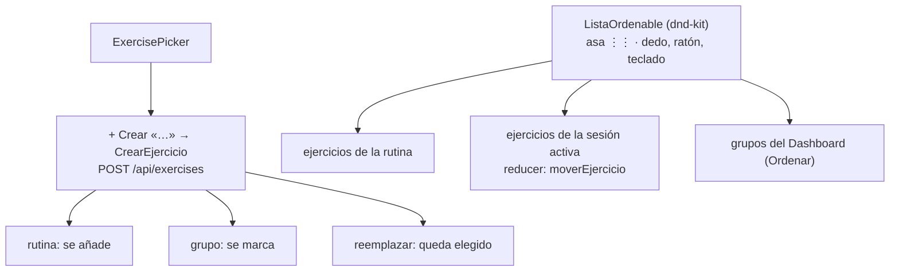

# Bloque 9b — Mejoras de uso

[← Índice](../README.md)

Estado: cerrado (2026-11-23)

## Objetivo

Pulir cómo se usa la app en el gimnasio: crear ejercicios sin salir de lo que estás haciendo,
distinguir ejercicios con el mismo nombre, ajustar el descanso en minutos, reordenar
arrastrando y que las esperas se entiendan.

## Qué se ha hecho

| Paso | Qué | Commit |
|---|---|---|
| 9b.1 | Crear un ejercicio desde el buscador (`CrearEjercicio` dentro de `ExercisePicker`) | `4eeef80` |
| 9b.2 | "Pecho · Máquinas" bajo el nombre (`NombreEjercicio`) | `0cde066` |
| 9b.3 | Descanso y series con selector por pasos (`SelectorPasos`, `utils/tiempo.js`) | `0e46a93` |
| 9b.4 | Arrastrar para reordenar con dnd-kit (`ListaOrdenable`, `utils/orden.js`) | `00dd79b` |
| 9b.5 | Esqueletos de carga (`Esqueleto`) y ticker de servidor dormido | `4b0c928`, `d796917` |
| — | Estilos comunes de formularios y logo alineado con el menú | `e7defb1`, `db85012` |

Antes del bloque se adelantó el paso 11.1 (límite de intentos, `d811291`, DECISIONS 0035).

## Pruebas

Desde `client/`: `node src/utils/orden.test.js` (incluye los 16 movimientos posibles),
`activeSessionReducer.test.js` (mover y reemplazar con grupo y tipo) y `grupos.test.js`.

## Decisiones del bloque

| # | Decisión |
|---|---|
| 0036 | Mejoras de uso: crear desde el buscador, etiquetas, selector por pasos, arrastrar y cargas |

## Qué cambió por el camino

- **Orden de trabajo:** el 11.1 (límite de intentos) se subió antes del 9b; por eso este bloque
  tiene la DECISIONS 0036 y el 11.1 la 0035.
- **Commits por paso con archivos compartidos:** varios pasos tocaban los mismos archivos; se
  guardó una copia de los archivos al terminar cada paso y se generó un parche por paso,
  comprobado aplicándolo en orden sobre el último commit.
