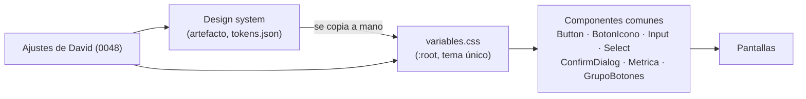

# Bloque 9c — Design system Premium

[← Índice](../README.md)

Estado: cerrado (2026-11-24)

## Objetivo

Aplicar a toda la app el tema Premium del design system de Yield Fit (un artefacto de claude.ai,
que pasa a ser la fuente de verdad del diseño): menos volumen, superficies por niveles, cifras que
mandan y movimiento con intención, sin cambiar la lógica.

## Qué se ha hecho

| Paso | Qué | Commits |
|---|---|---|
| 0 | Fuente de verdad del diseño, roadmap y DECISIONS 0047 | `eeac72e` |
| 1 | Tokens del tema Premium en `variables.css` | `c8d1fc7` |
| 2 | Geist Mono para cifras y datos | `00cefbf` |
| — | Negro del tema en el fondo de la app (DarkVeil) | `886ce0f` |
| 3 | Button: tamaños, `ghost`, `primary` en `color-action` y `danger` tonal | `33fd5ab` |
| 4 | Foco suave en Input y Select | `113b368` |
| 5 | Iconos de trazo 1.5 | `655154d` |
| — | Ajustes de David: botón principal verde, rojo `#ec5850`, `BotonIcono`, intro en negro puro | `8d3d35d`, `911b0c6`, `0d71527`, `67296ed` |
| 6 | Componente `Metrica` y fila de resumen del Dashboard | `5ccde35` |
| 7 | Transiciones por propiedad, pulsado y entrada de los diálogos | `0271ef2` |
| 8 | rgba sueltos y colores de Recharts a tokens | `4b4e0db`, `e882fc5` |
| — | Documentación: deuda de dependencias y DECISIONS 0048 | `e7793ec`, `764c00d` |

## Pruebas

- Medidas en el navegador (Chrome sin ventana) a 375, 390 y 1280 px en tres paradas de
  revisión: sin desbordes ni scroll horizontal.
- Dashboard con datos reales (cuenta desechable) para ver `Metrica` y la gráfica.
- `node src/utils/formato.test.js` desde `client/`.

## Decisiones del bloque

| # | Decisión |
|---|---|
| 0047 | Design system Premium como tema único y fuente de verdad del diseño |
| 0048 | Ajustes al tema Premium: botón verde, rojo más vivo, botones de icono y portada en negro puro |

## Qué cambió por el camino

- **Revisión visual en tres paradas** en lugar de una por punto; de ellas salieron los ajustes de
  la 0048 (el botón blanco del Premium no encajaba con la marca; el rojo, demasiado apagado).
- **La portada sin sesión mantiene su aspecto** (fondo animado y degradado en negro puro).
- **El artefacto del design system se actualizó** para decir lo mismo que el código.
- **Aparecieron vulnerabilidades en dependencias** al instalar Geist Mono: quedaron en la deuda,
  priorizando el servidor.
- **Pendiente:** colores translúcidos sin token (deuda en CLAUDE.md) y los iconos del grupo
  "Icons" del artefacto, que siguen con trazo 2.
