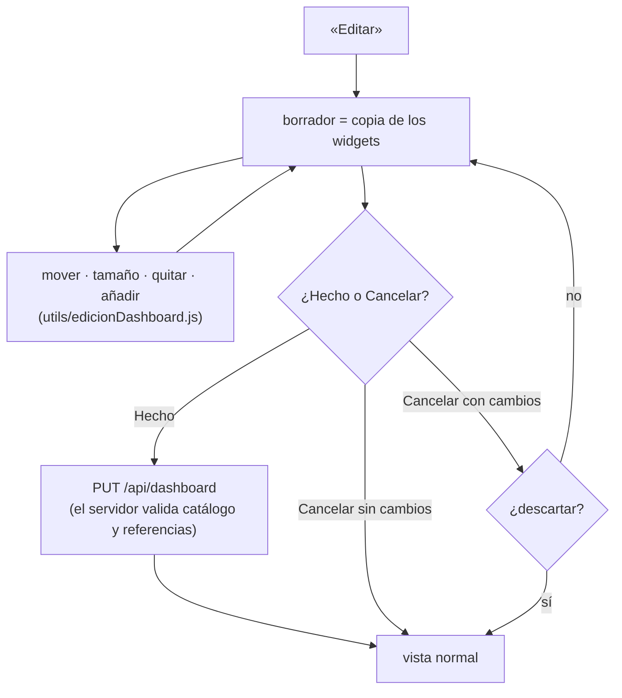

# Bloque 9d — Dashboard personalizable

[← Índice](../README.md)

Estado: cerrado (2026-11-25)

## Objetivo

Un dashboard ("Inicio") tipo bento, guardado en el servidor e igual en todos los dispositivos:
widgets y grupos al mismo nivel, en una retícula estricta, que cada usuario ordena, redimensiona,
quita y añade desde un catálogo. Decisiones: [0052](../../DECISIONS.md) y [0054](../../DECISIONS.md).

## Qué se ha hecho

| Paso | Qué | Commits |
|---|---|---|
| 1 | Dashboard en el servidor, "Todos" como grupo normal y retícula de widgets | `faa88fb` `e61a7f4` `b088cb1` `6c2a6fc` `4053c2f` `103dcbd` `5117f9e` `7cc8bc4` |
| 1b | Widgets de actividad, última sesión, récords y racha; ajustes de las revisiones | `ddc573e` `4f1f190` `aaab1c7` `bbffa23` `5be6ea8` `17a2464` `2f6f06a` `6e1d72b` `43a9937` `ef9705e` `8ed9f0e` `05f3060` `641d407` `0bdc6cf` `ddb848a` |
| 1c | Anatomía común de widget aprobada en el design system; llama de la racha | `f9c0988` `fee01dd` `49335dd` `fbdf597` `b20aac8` |
| 1d | Más aire, etiqueta en pastilla y Racha sin pie | `649ec1c` `45250cf` `87ec6fe` |
| 2 | Récord de un ejercicio y Empezar rutina | `16ead5d` `354c89e` `cc9bd47` `7480e05` `133960e` |
| 3 | Modo edición: borrador, catálogo, huecos y arrastre | `b3e19d9` `c2e7a82` `75e7f0c` `c4482c1` |

## Cómo funciona el modo edición

- **Retícula:** `utils/reticula.js` coloca cada widget en orden, sin `dense`, y devuelve los huecos.
  Al añadir en un hueco, el widget se inserta delante del primero que va después del hueco.
- **Arrastre:** dnd-kit con una estrategia que no desplaza a los demás; el sitio de origen y el
  destino se marcan y se recoloca al soltar. Funciona con el dedo (desde el asa), el ratón y el
  teclado (las flechas siguen la dirección de la retícula).
- **Catálogo:** hoja en el móvil y ventana en escritorio, en un portal. Los de un solo dato que ya
  están salen como "Ya está"; récord, rutina y grupo tienen un segundo paso para elegir.

## Pruebas

- Funciones puras con pruebas sin dependencias: `edicionDashboard.test.js`, `actividad.test.js`,
  `formato.test.js` y `reticula.test.js`.
- Servidor contra la base de desarrollo: endpoints de actividad, récords, récord de un ejercicio y
  resumen de rutinas; `explain` de las consultas (índices `records_por_ejercicio` y
  `{ userId, workoutId, fecha }`).
- Chrome a 375, 390, 1024 y 1280 px: sin huecos en el dashboard por defecto, sin desbordes ni
  textos cortados, alineación de cabeceras y cifras, los tres estados de la racha, el peor caso de
  "+100 %" y "+104 semanas", y el modo edición entero (añadir, quitar, tamaños, arrastrar con ratón
  y teclado, guardar y recargar, avisos).

## Decisiones del bloque

| # | Decisión |
|---|---|
| 0052 | Dashboard personalizable en el servidor, con "Todos" como grupo normal |
| 0054 | Widgets con anatomía común aprobada en el design system, y edición del dashboard con borrador |

## Qué cambió por el camino

- **Los widgets se diseñan primero en el design system** y David los aprueba allí: anatomía común,
  más aire tras su revisión, etiqueta en pastilla y la Racha (de Strava a la llama con tres estados).
- **Las cifras a 32 px no cabían en el móvil** con datos reales ("+21,9 %", "3 semanas"): el % pasó
  a unidad pequeña y la Racha en P lleva "semanas" en el pie.
- **El récord de un ejercicio necesitó un índice propio**: el de la serie anterior leía todas las
  sesiones del ejercicio.
- **Al arrastrar, los widgets se recolocan al soltar** y no en vivo, como decía el diseño aprobado:
  con tamaños distintos, el reflujo en vivo hacía parpadear el arrastre.
