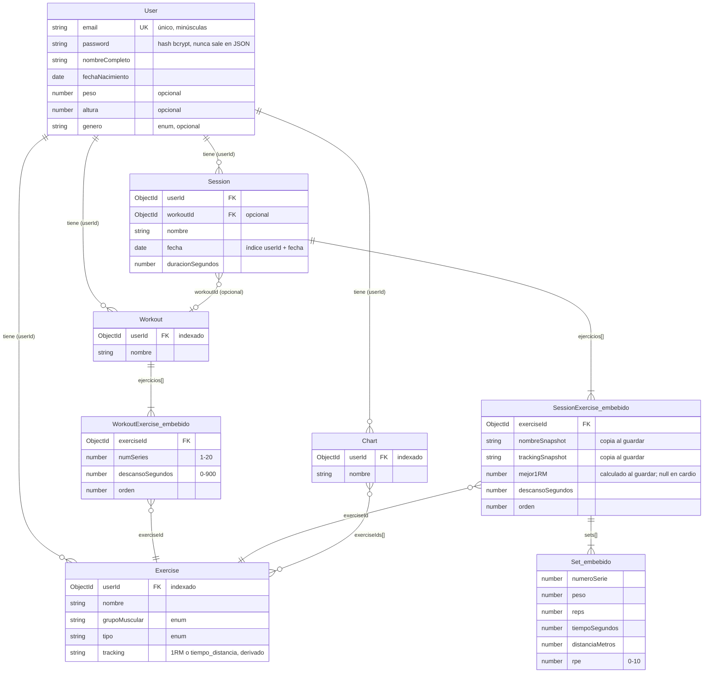
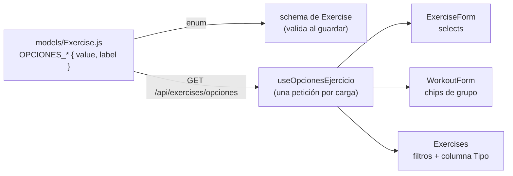
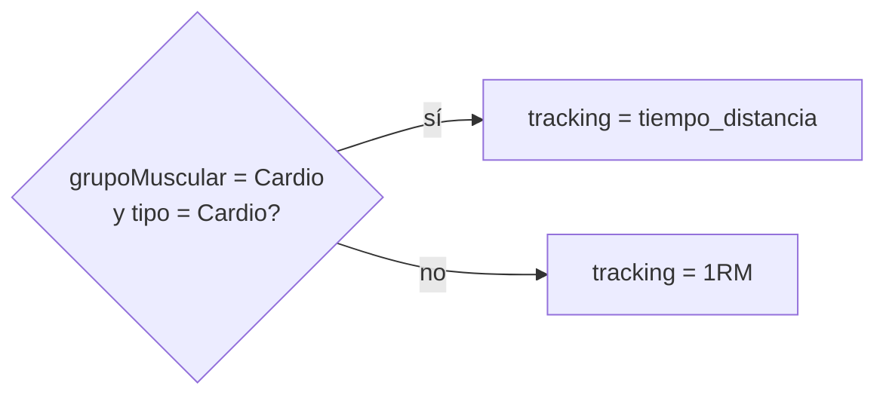
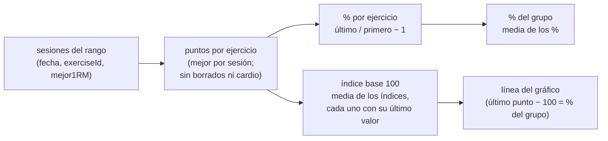
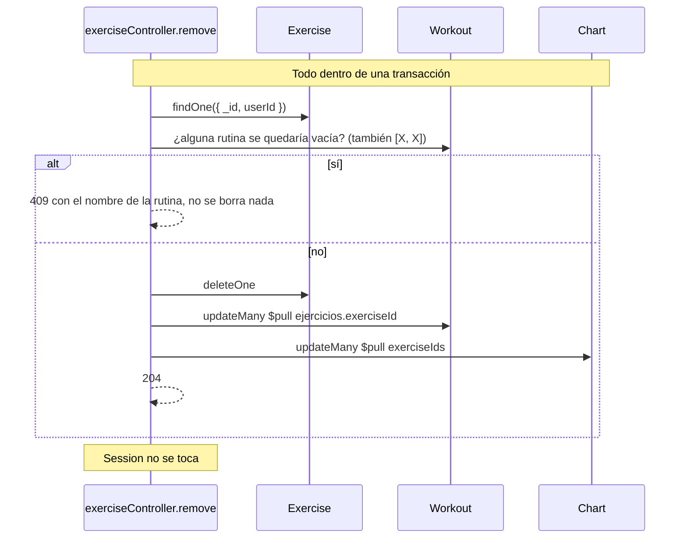

# Modelo de datos

[← Índice](README.md)

Cinco colecciones en MongoDB (una por modelo de Mongoose en `server/models/`). La regla de
diseño ([0003](../DECISIONS.md)): **embeber lo que se lee junto al padre y referenciar lo que
existe de forma independiente**.

## Diagrama

Las entidades marcadas como *embebido* no son colecciones: viven dentro del documento padre.

Todos los modelos tienen además `createdAt` y `updatedAt` (`timestamps: true`).

## Modelos

### User
- La contraseña se hashea con bcrypt en `pre('save')`, solo si ha cambiado (`isModified`).
- `toJSON` borra `password`, así que nunca sale en una respuesta de la API.
- `comparePassword()` se usa en el login (ver [auth.md](auth.md)).

### Exercise
- **Por usuario:** al registrarse, se clonan 58 presets de `server/data/exercisePresets.js`
  ([0002](../DECISIONS.md)).
- `grupoMuscular` y `tipo` son enums. Sus valores, con el texto que ve el usuario, viven
  **solo** en `models/Exercise.js` (`OPCIONES_GRUPO_MUSCULAR`, `OPCIONES_TIPO`). El cliente los
  pide a `GET /api/exercises/opciones` con el hook `useOpcionesEjercicio`
  ([0024](../DECISIONS.md)):

  `value` es lo que se guarda y no se cambia nunca; `label` es solo presentación (por eso
  `Maquinas` se muestra como "Máquinas"). Una opción con `disponible: false` (hoy, Cardio) se
  muestra como "Próximamente" y no se puede elegir ([0030](../DECISIONS.md)).
- `tracking` no lo elige el usuario: lo calcula `pre('save')` ([0006](../DECISIONS.md)).

La regla vive en una sola función, `derivarTracking`, exportada desde `models/Exercise.js`. La
usan el `pre('save')` y el clonado de presets (`utils/presets.js`). El clonado no puede depender
del middleware porque usa `insertMany`, que no ejecuta `pre('save')`.

### Workout
Plantilla de rutina. `ejercicios[]` embebido, con al menos 1 elemento (validador del schema).

### Session
Entrenamiento realizado.
- `ejercicios[]` (al menos 1) y, dentro de cada uno, `sets[]` (al menos 1).
- **Snapshots** ([0004](../DECISIONS.md)): al crear la sesión, el controlador lee cada
  `Exercise` y copia `nombre → nombreSnapshot` y `tracking → trackingSnapshot`. Así, renombrar
  un ejercicio no cambia el historial.
- **No se editan:** no hay `PUT /api/sessions/:id`. El que había regeneraba los snapshots con
  los nombres actuales y el cliente nunca lo usó; se eliminó en el bloque 1. Una sesión solo se
  crea o se borra.
- **`mejor1RM`** en cada ejercicio ([0026](../DECISIONS.md)): el mejor 1RM estimado (Epley) de sus
  series, calculado una vez al guardar con `utils/unaRM.js`; null en tiempo/distancia. Las
  sesiones anteriores al bloque 4 lo recibieron con `npm run migrar:1rm`.
- **Índice `{ userId: 1, fecha: -1 }`:** lo usan las dos consultas que crecen con el historial:
  la lista paginada (`GET /api/sessions`, de la más reciente a la más antigua) y el progreso de
  un rango (`GET /api/progress`).
- **Índice `{ userId: 1, 'ejercicios.exerciseId': 1, fecha: -1 }`** ([0029](../DECISIONS.md)):
  la serie anterior (`GET /api/sessions/previous-sets`) busca la última sesión con cada
  ejercicio. Es multikey: una entrada por ejercicio de cada sesión. Sin él, un ejercicio que no
  se ha hecho nunca recorría todo el historial.

#### Cómo se calcula el progreso

`GET /api/progress?desde&hasta` lee solo fecha, `exerciseId` y `mejor1RM` de las sesiones del
rango, y `utils/progreso.js` calcula:

Ejemplo: sentadilla 150 → 165 (+10 %, índice 110) y curl 20 → 21 (+5 %, índice 105): el grupo
sube un 7,5 % y la línea acaba en 107,5.

### Chart
Grupo de ejercicios para el progreso (`nombre`, `exerciseIds[]`). CRUD hecho en el backend,
**sin uso en el cliente todavía** (bloque 9).

## Borrar un ejercicio: el historial se conserva

Decisión [0020](../DECISIONS.md), que sustituye a la cascada de la 0005. El ejercicio se borra de
verdad y desaparece de rutinas y grupos, pero **las sesiones pasadas lo conservan**: su nombre está
en `nombreSnapshot`. Lo que cambia es que deja de contar en el progreso.

Dónde se nota en el cliente:

| Sitio | Qué hace |
|---|---|
| Diálogo de borrado (`utils/borradoEjercicio.js`) | Explica que se quita de rutinas y grupos y que el historial se conserva |
| Progreso (`GET /api/progress`) | El servidor excluye del cálculo los ejercicios que ya no existen |
| Historial | Muestra la sesión tal cual, con el nombre del snapshot |
| Empezar sesión desde rutina (`useStartSession`) | No incluye ejercicios inexistentes; si no queda ninguno, pide editar la rutina |
| Terminar sesión activa (`ActiveSession.jsx`) | Comprueba qué ejercicios siguen existiendo; no envía las series de los borrados y avisa con su nombre |

Los restos de la cascada antigua (sesiones vacías, rutinas con ids inexistentes) se detectan con
`npm run diagnostico:borrados` y se repararon una vez con `npm run reparar:borrados`
([operaciones.md](operaciones.md)).

## Qué crece con el tiempo

Según el principio de estabilidad ([0015](../DECISIONS.md)), lo que importa es qué colecciones
crecen sin límite:

| Colección | Crecimiento | Estado |
|---|---|---|
| Session | una por entrenamiento, indefinidamente | indexada; lista paginada por cursor, progreso por rango sin leer las series (bloque 4) y serie anterior por índice (bloque 5) |
| Exercise | ~58 + los que cree el usuario | acotada |
| Workout, Chart | pocas por usuario | acotadas |
