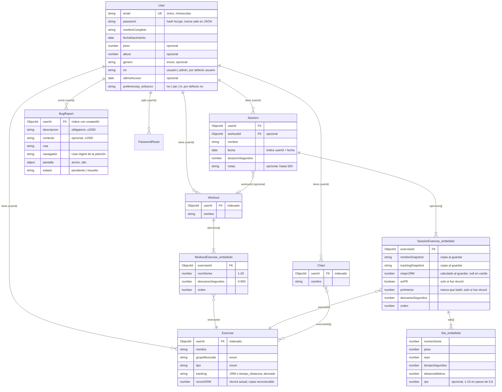
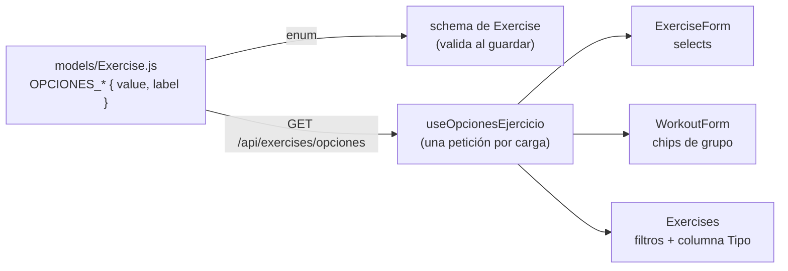
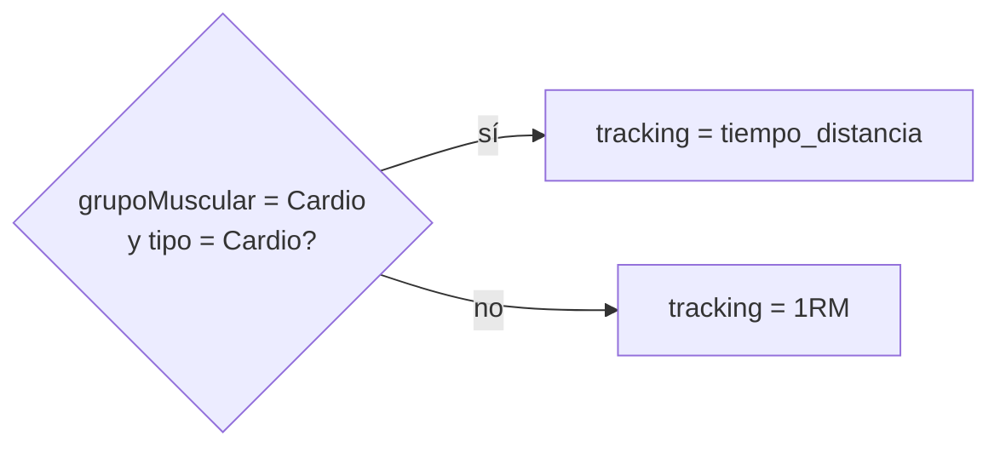
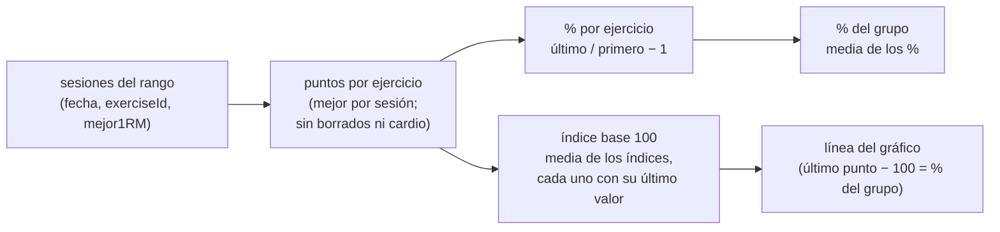
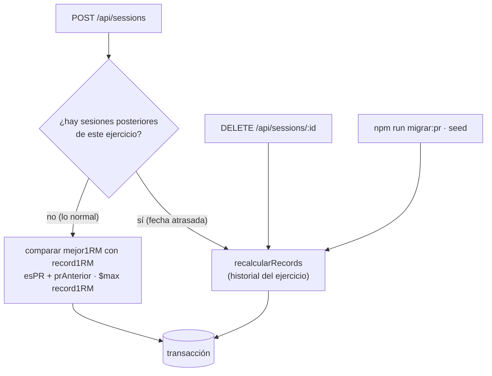
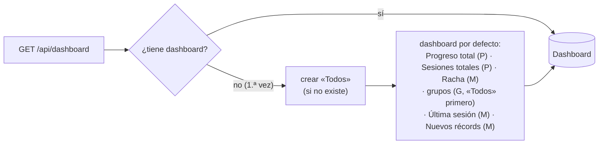
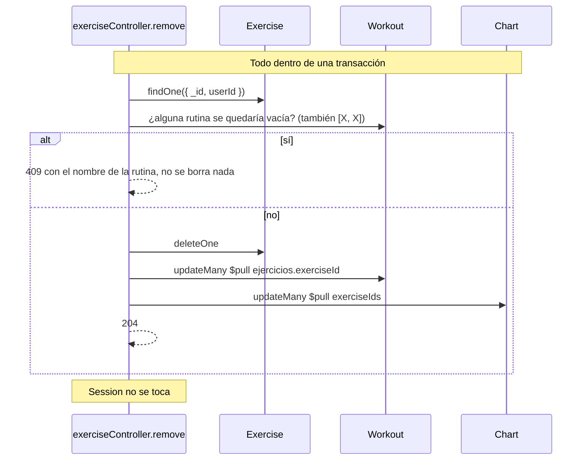

# Modelo de datos

[← Índice](README.md)

Cinco colecciones en MongoDB (una por modelo de Mongoose en `server/models/`). La regla de
diseño ([0003](../DECISIONS.md)): **embeber lo que se lee junto al padre y referenciar lo que
existe de forma independiente**.

## Diagrama

Las entidades marcadas como *embebido* no son colecciones: viven dentro del documento padre.

Todos los modelos tienen además `createdAt` y `updatedAt` (`timestamps: true`).

## Modelos

### User
- La contraseña se hashea con bcrypt en `pre('save')`, solo si ha cambiado (`isModified`).
- `toJSON` borra `password`, así que nunca sale en una respuesta de la API.
- `comparePassword()` se usa en el login (ver [auth.md](auth.md)).
- `rol` (`usuario` | `admin`, bloque 11b): ninguna ruta de la API lo acepta; se asigna con
  `npm run admin` ([operaciones.md](operaciones.md)). Los usuarios anteriores no tienen el campo:
  Mongoose les aplica `usuario` al leerlos.
- `ultimoAcceso`: se guarda al registrarse, iniciar sesión y renovar el token, como mucho una vez
  por hora (`utils/ultimoAcceso.js`), sin tocar `updatedAt`.
- `preferencias.esfuerzo` ([0056](../DECISIONS.md), bloque 5c): cómo ver el esfuerzo por serie (`no`,
  `rpe` o `rir`; por defecto `no`). Solo la cambia `PUT /api/auth/me/preferencias`. Los usuarios
  anteriores no tienen el campo: Mongoose les aplica el valor por defecto al leerlos.
- **Borrar la cuenta** (bloque 11b, [auth.md](auth.md#borrar-la-cuenta)) borra en una transacción
  el usuario y todos los documentos con su `userId` en las demás colecciones.

### Exercise
- **Por usuario:** al registrarse, se clonan 58 presets de `server/data/exercisePresets.js`
  ([0002](../DECISIONS.md)).
- `grupoMuscular` y `tipo` son enums. Sus valores, con el texto que ve el usuario, viven
  **solo** en `models/Exercise.js` (`OPCIONES_GRUPO_MUSCULAR`, `OPCIONES_TIPO`). El cliente los
  pide a `GET /api/exercises/opciones` con el hook `useOpcionesEjercicio`
  ([0024](../DECISIONS.md)):

  `value` es lo que se guarda y no se cambia nunca; `label` es solo presentación (por eso
  `Maquinas` se muestra como "Máquinas"). Una opción con `disponible: false` (hoy, Cardio) se
  muestra como "Próximamente" y no se puede elegir ([0030](../DECISIONS.md)).
- `tracking` no lo elige el usuario: lo calcula `pre('save')` ([0006](../DECISIONS.md)).

- **`record1RM`** ([0051](../DECISIONS.md)): el mejor 1RM estimado de todas las sesiones del
  ejercicio. Es una copia de lo que dicen las sesiones, para decidir los récords sin recorrer el
  historial (ver [Récords personales](#récords-personales)). Solo la escribe el servidor.

La regla vive en una sola función, `derivarTracking`, exportada desde `models/Exercise.js`. La
usan el `pre('save')` y el clonado de presets (`utils/presets.js`). El clonado no puede depender
del middleware porque usa `insertMany`, que no ejecuta `pre('save')`.

### Workout
Plantilla de rutina. `ejercicios[]` embebido, con al menos 1 elemento (validador del schema).

### Session
Entrenamiento realizado.
- `ejercicios[]` (al menos 1) y, dentro de cada uno, `sets[]` (al menos 1).
- **Snapshots** ([0004](../DECISIONS.md)): al crear la sesión, el controlador lee cada
  `Exercise` y copia `nombre → nombreSnapshot` y `tracking → trackingSnapshot`. Así, renombrar
  un ejercicio no cambia el historial.
- **No se editan:** no hay `PUT /api/sessions/:id`. El que había regeneraba los snapshots con
  los nombres actuales y el cliente nunca lo usó; se eliminó en el bloque 1. Una sesión solo se
  crea o se borra.
- **`mejor1RM`** en cada ejercicio ([0026](../DECISIONS.md)): el mejor 1RM estimado (Epley) de sus
  series, calculado una vez al guardar con `utils/unaRM.js`; null en tiempo/distancia. Las
  sesiones anteriores al bloque 4 lo recibieron con `npm run migrar:1rm`.
- **Índice `{ userId: 1, fecha: -1 }`:** lo usan las dos consultas que crecen con el historial:
  la lista paginada (`GET /api/sessions`, de la más reciente a la más antigua) y el progreso de
  un rango (`GET /api/progress`).
- **Índice `{ userId: 1, 'ejercicios.exerciseId': 1, fecha: -1 }`** ([0029](../DECISIONS.md)):
  la serie anterior (`GET /api/sessions/previous-sets`) busca la última sesión con cada
  ejercicio. Es multikey: una entrada por ejercicio de cada sesión. Sin él, un ejercicio que no
  se ha hecho nunca recorría todo el historial.
- **`notas`** ([0055](../DECISIONS.md), bloque 11d): texto libre del usuario sobre el entreno, hasta
  500 caracteres; sin campo si no hay nota. Como el resto de la sesión, no se edita.
- **Índice `{ userId: 1, workoutId: 1, fecha: -1 }`** ([0055](../DECISIONS.md)): "la nota de la
  última vez" (`GET /api/sessions/previous-note`) y la última sesión de cada rutina del widget
  "Empezar rutina" leen un solo documento.
- **Índice parcial `records_por_ejercicio`** `{ 'ejercicios.exerciseId': 1, fecha: -1 }`, solo con
  las sesiones que tienen algún récord ([0054](../DECISIONS.md), bloque 9d): el widget "Récord de un
  ejercicio" (`GET /api/estadisticas/record`) lee los récords de un ejercicio sin recorrer todas sus
  sesiones. La consulta incluye `'ejercicios.esPR': true` y lo nombra con `hint`.

#### Cómo se calcula el progreso

`GET /api/progress?desde&hasta` lee solo fecha, `exerciseId` y `mejor1RM` de las sesiones del
rango, y `utils/progreso.js` calcula:

Ejemplo: sentadilla 150 → 165 (+10 %, índice 110) y curl 20 → 21 (+5 %, índice 105): el grupo
sube un 7,5 % y la línea acaba en 107,5.

#### Récords personales

Decisión [0051](../DECISIONS.md), bloque 4b. Un ejercicio de una sesión es **récord** (PR) cuando su
`mejor1RM` supera estrictamente el mejor de todas las sesiones anteriores de ese ejercicio. La
primera vez solo fija la marca; igualar no cuenta; el cardio nunca. Si un ejercicio sale dos veces
en la sesión, solo cuenta la mejor. La regla vive en `utils/records.js` (con pruebas en
`records.test.js`).

- **Al guardar** se compara con `Exercise.record1RM`: no se lee el historial. La sesión guarda
  `esPR` y `prAnterior` en el ejercicio que batió la marca, y `record1RM` sube con `$max`, todo en
  una transacción. La respuesta del `POST` lleva las marcas (para el aviso del Historial).
- **Al borrar una sesión** se recalculan desde cero sus ejercicios de fuerza: todas sus sesiones
  en orden de fecha (sin series) y `record1RM`. Si la borrada era un error (500 kg en vez de 50),
  los récords reales posteriores vuelven a aparecer.
- **Una sesión con fecha atrasada** (anterior a otra ya guardada del mismo ejercicio; hoy la app
  no lo hace) también recalcula ese ejercicio entero.
- **Borrar un ejercicio** no toca nada: las sesiones conservan sus marcas, como su nombre.
- `GET /api/sessions/days` añade `tienePR` a cada sesión. `npm run migrar:pr` marca las sesiones
  anteriores al bloque y reconstruye todo si alguna vez no cuadra ([operaciones.md](operaciones.md)).

### Chart
Grupo de progreso (`nombre`, `exerciseIds[]`); en la app se llama "grupo" ([0034](../DECISIONS.md)).
Se crea y edita en `/groups/new` y `/groups/:id/edit`. Su progreso lo calcula
`GET /api/progress?grupo=<id>` con **exactamente el mismo cálculo que "Todos"**, solo con sus
ejercicios: la lista la lee el servidor del propio grupo. Al borrar un ejercicio se quita de
los grupos (0020); un grupo puede quedarse vacío y la tarjeta lo avisa.
- **"Todos"** ([0052](../DECISIONS.md), bloque 9d) es un grupo normal con `todos: true` y sin
  lista: su progreso cuenta todos los ejercicios que existen hoy, también los que se creen
  después. Se puede renombrar, borrar y volver a crear (`POST /api/charts` con `todos: true`);
  nunca lleva una lista elegida a mano. Índice único parcial: como mucho uno por usuario.

### Dashboard
Dashboard personalizable de cada usuario ([0052](../DECISIONS.md), bloque 9d): un documento con
la lista de widgets en orden (`tipo`, `tamano` P/M/G, `chartId`, `exerciseId` o `workoutId` según
el tipo, y `rango`). Los tipos, sus tamaños y los rangos vienen de `data/catalogoWidgets.js`, que
el cliente pide a `GET /api/dashboard/catalogo` (con `camposReferencia`: en qué campo va cada
referencia). `PUT /api/dashboard` guarda la lista entera tras validarla (`utils/dashboard.js`): lo
usa el botón "Hecho" del modo edición ([0054](../DECISIONS.md)) y el cambio de rango de un grupo.
Al borrar un grupo, un ejercicio o una rutina se quita su widget en la misma transacción.

### BugReport
Reporte de un fallo enviado con el botón de la app (bloque 11b): `POST /api/reports`, 5 por hora
por usuario. El cliente manda `descripcion`, `contexto`, `ruta` y `pantalla`; el navegador lo toma
el servidor de la cabecera `User-Agent`, y `estado` (`pendiente` por defecto) solo lo cambia el
admin. Solo texto: nunca capturas de pantalla. Se borran con la cuenta del usuario (11b.4).
Índices `{ userId, createdAt }`, `{ estado, createdAt }` y `{ createdAt }`: la bandeja de
`/developer` ordena del más reciente al más antiguo y filtra por usuario, por estado o por fechas,
paginada por cursor como el Historial.

### PasswordReset
Enlace para recuperar la contraseña por email (bloque 11b): `userId`, `hash` (SHA-256 del token;
el token en claro solo va en el email), `usadoEn` y `expiresAt` (30 minutos, con índice TTL que
borra los caducados). Como mucho uno sin usar por usuario. Ver [auth.md](auth.md#recuperar-la-contraseña-por-email).

## Borrar un ejercicio: el historial se conserva

Decisión [0020](../DECISIONS.md), que sustituye a la cascada de la 0005. El ejercicio se borra de
verdad y desaparece de rutinas y grupos, pero **las sesiones pasadas lo conservan**: su nombre está
en `nombreSnapshot`. Lo que cambia es que deja de contar en el progreso.

Dónde se nota en el cliente:

| Sitio | Qué hace |
|---|---|
| Diálogo de borrado (`utils/borradoEjercicio.js`) | Explica que se quita de rutinas y grupos y que el historial se conserva |
| Progreso (`GET /api/progress`) | El servidor excluye del cálculo los ejercicios que ya no existen |
| Historial | Muestra la sesión tal cual, con el nombre del snapshot |
| Empezar sesión desde rutina (`useStartSession`) | No incluye ejercicios inexistentes; si no queda ninguno, pide editar la rutina |
| Terminar sesión activa (`ActiveSession.jsx`) | Comprueba qué ejercicios siguen existiendo; no envía las series de los borrados y avisa con su nombre |

Los restos de la cascada antigua (sesiones vacías, rutinas con ids inexistentes) se detectan con
`npm run diagnostico:borrados` y se repararon una vez con `npm run reparar:borrados`
([operaciones.md](operaciones.md)).

## Qué crece con el tiempo

Según el principio de estabilidad ([0015](../DECISIONS.md)), lo que importa es qué colecciones
crecen sin límite:

| Colección | Crecimiento | Estado |
|---|---|---|
| Session | una por entrenamiento, indefinidamente | indexada; lista paginada por cursor, progreso por rango sin leer las series (bloque 4), serie anterior por índice (bloque 5) y récords al guardar sin leer el historial (bloque 4b) |
| Exercise | ~58 + los que cree el usuario | acotada |
| Workout, Chart | pocas por usuario | acotadas |
