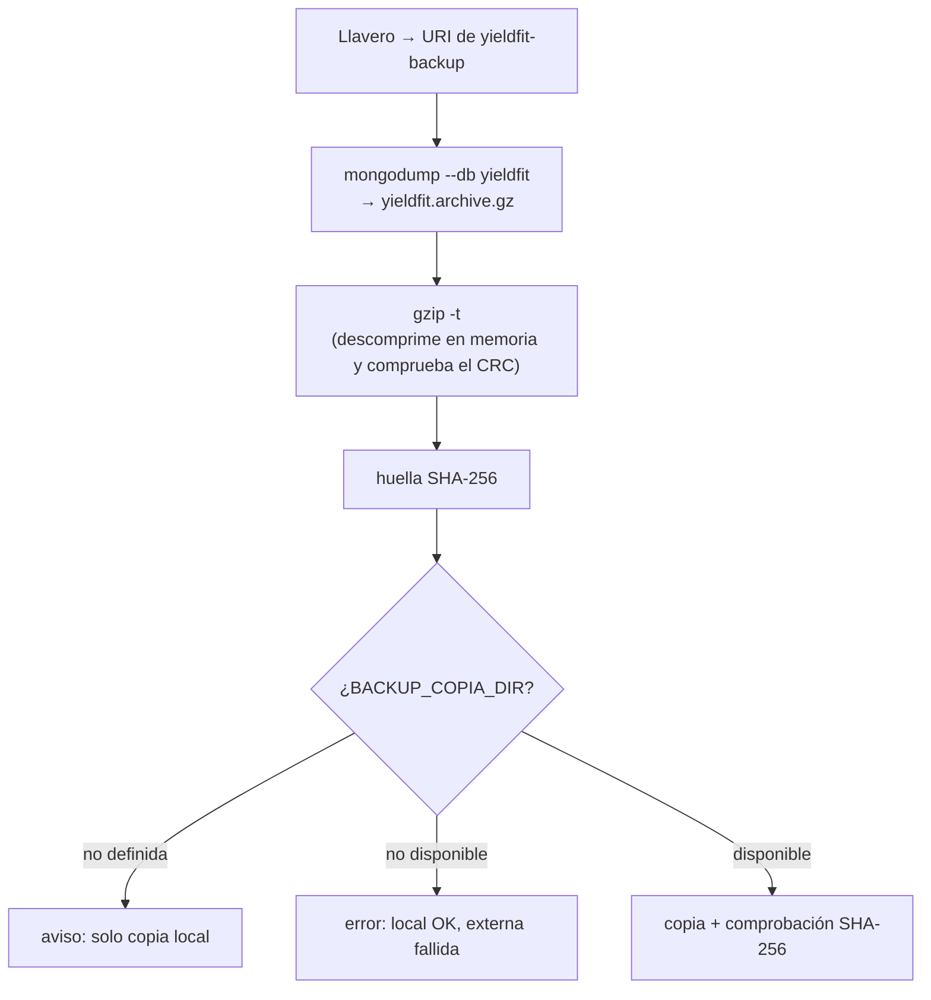

# Operaciones: backups y restauración

[← Índice](README.md)

Atlas M0 **no tiene backups automáticos**. Las copias de producción se hacen con `mongodump`
desde el portátil ([0018](../DECISIONS.md)).

## Cuándo hacer un backup

- **Obligatorio:** justo antes de cualquier cambio que modifique documentos existentes (p. ej. la
  migración de sesiones del bloque 4).
- **Rutina:** una vez al mes.
- Después de cada backup importante, la prueba de restauración (ver abajo).

## Requisitos (una sola vez, en este orden)

1. **FileVault activado** (Ajustes del Sistema → Privacidad y seguridad → FileVault). Los backups
   contienen datos personales de los usuarios; sin cifrado de disco, perder el portátil es perder
   esos datos.
2. **Herramientas de MongoDB:**
   ```bash
   brew install mongodb-database-tools
   ```
3. **Usuario de Atlas `yieldfit-backup`** (Security → Database Access → Add New Database User,
   autenticación por contraseña autogenerada, *Specific Privileges*):
   - `read` sobre `yieldfit`: puede copiar producción, nunca modificarla.
   - `readWrite` sobre `yieldfit-restore-test`: solo para la prueba de restauración.
4. **Guardar su URI en el Llavero** (te la pide sin mostrarla y no queda en el historial):
   ```bash
   security add-generic-password -s yieldfit-backup -a "$USER" -w
   ```
   La URI es la de conexión de Atlas con ese usuario. Los scripts la leen del Llavero en cada
   ejecución; no está en ningún archivo.

> **Las credenciales nunca salen en pantalla.** `mongodump` y `mongorestore` imprimen la URI
> completa, con contraseña, cuando no pueden conectar. Por eso los scripts
> (`server/scripts/lib/credenciales.sh`) pasan la URI por `--config` y no como argumento (los
> argumentos se ven con `ps`), y filtran toda su salida, terminal y logs, sustituyendo la
> contraseña por `***`. No ejecutes `mongodump` o `mongorestore` a mano con `--uri`: usa los
> scripts.
5. **Segunda copia (recomendado):** define `BACKUP_COPIA_DIR` en `~/.zshrc` con una carpeta fuera
   del portátil (p. ej. del NAS):
   ```bash
   export BACKUP_COPIA_DIR="/Volumes/NAS/yieldfit-backups"
   ```

## Hacer un backup

```bash
cd server
npm run backup
```



`gzip -t` demuestra que el archivo está **íntegro**; que se puede **restaurar** solo lo demuestra la
prueba de restauración. Si el script no puede leer los recuentos por colección del log, falla
con un mensaje explícito: nunca termina en silencio.

Resultado en `~/yieldfit-backups/AAAA-MM-DD_HHMM/` (permisos `700`, solo tu usuario):

| Archivo | Contenido |
|---|---|
| `yieldfit.archive.gz` | la base completa, comprimida |
| `yieldfit.archive.gz.sha256` | huella para comprobar que una copia es idéntica |
| `mongodump.log` | documentos volcados por colección |

## Probar la restauración

```bash
npm run backup:restore-test                                   # el backup más reciente
npm run backup:restore-test -- ~/yieldfit-backups/AAAA-MM-DD_HHMM
```

1. Comprueba la huella SHA-256 del archivo.
2. Lo restaura en **`yieldfit-restore-test`** (nunca en `yieldfit`; además, el usuario de backup
   no tiene permiso de escritura en producción).
3. Compara colección por colección los documentos restaurados con los volcados: cada colección
   tiene que aparecer, con los mismos documentos y 0 fallos, y la línea final de `mongorestore`
   tiene que confirmar 0 documentos fallidos. Cualquier cosa que no pueda leer cuenta como fallo.

Al terminar, **borra `yieldfit-restore-test` desde Atlas** (Browse Collections → la base → Drop):
es una copia de producción y ocupa espacio de los 512 MB del M0.

## Restaurar producción de verdad

Solo en caso de pérdida de datos. Es una operación manual y deliberada, sin script: hace falta un
usuario con escritura sobre `yieldfit` (el de producción) y `mongorestore --drop` sobre esa base.
Antes, haz un backup del estado actual, aunque esté dañado.

## Mantenimiento

- Los scripts no borran backups antiguos: hazlo a mano.
- Revisión prevista ([0018](../DECISIONS.md)): backups automáticos fuera del portátil cuando la app
  tenga usuarios reales además de David.
