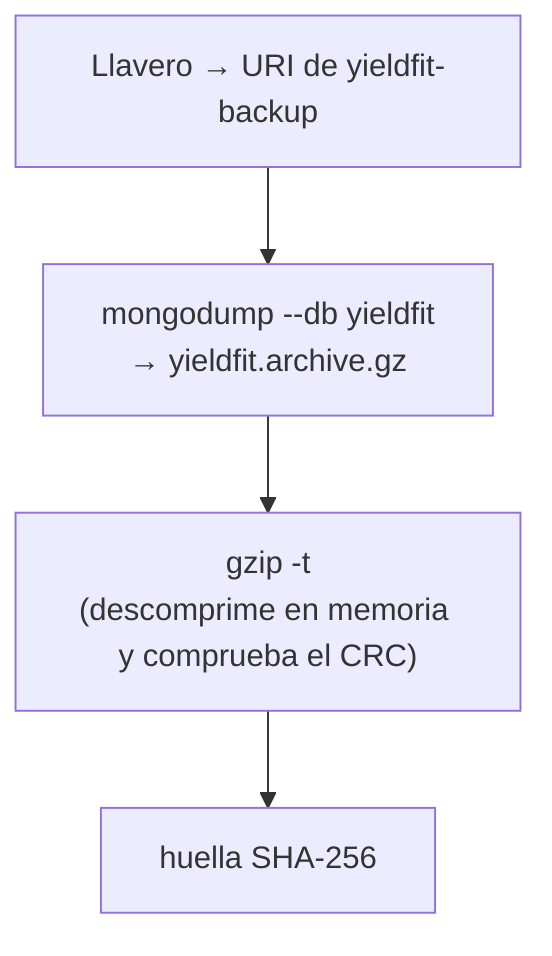
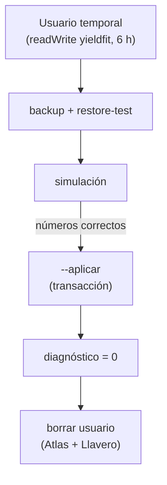

# Operaciones: backups, restauración y reparaciones

[← Índice](README.md)

Atlas M0 **no tiene backups automáticos**. Las copias de producción se hacen con `mongodump`
desde el portátil ([0018](../DECISIONS.md)).

## Cuándo hacer un backup

- **Obligatorio:** justo antes de cualquier cambio que modifique documentos existentes (p. ej. la
  migración de sesiones del bloque 4).
- **Rutina:** una vez al mes.
- Después de cada backup importante, la prueba de restauración (ver abajo).

## Requisitos (una sola vez, en este orden)

1. **FileVault activado** (Ajustes del Sistema → Privacidad y seguridad → FileVault). Los backups
   contienen datos personales de los usuarios; sin cifrado de disco, perder el portátil es perder
   esos datos.
2. **Herramientas de MongoDB:**
   ```bash
   brew install mongodb-database-tools
   ```
3. **Usuario de Atlas `yieldfit-backup`** (Security → Database Access → Add New Database User,
   autenticación por contraseña autogenerada, *Specific Privileges*):
   - `read` sobre `yieldfit`: puede copiar producción, nunca modificarla.
   - `readWrite` sobre `yieldfit-restore-test`: solo para la prueba de restauración.
4. **Guardar su URI en el Llavero** (te la pide sin mostrarla y no queda en el historial):
   ```bash
   security add-generic-password -s yieldfit-backup -a "$USER" -w
   ```
   La URI es la de conexión de Atlas con ese usuario. Los scripts la leen del Llavero en cada
   ejecución; no está en ningún archivo.

> **Las credenciales nunca salen en pantalla.** `mongodump` y `mongorestore` imprimen la URI
> completa, con contraseña, cuando no pueden conectar. Por eso los scripts
> (`server/scripts/lib/credenciales.sh`) pasan la URI por `--config` y no como argumento (los
> argumentos se ven con `ps`), y filtran toda su salida, terminal y logs, sustituyendo la
> contraseña por `***`. No ejecutes `mongodump` o `mongorestore` a mano con `--uri`: usa los
> scripts.
## Hacer un backup

```bash
cd server
npm run backup
```



`gzip -t` demuestra que el archivo está **íntegro**; que se puede **restaurar** solo lo demuestra la
prueba de restauración. Si el script no puede leer los recuentos por colección del log, falla
con un mensaje explícito: nunca termina en silencio.

Resultado en `~/yieldfit-backups/AAAA-MM-DD_HHMM/` (permisos `700`, solo tu usuario):

| Archivo | Contenido |
|---|---|
| `yieldfit.archive.gz` | la base completa, comprimida |
| `yieldfit.archive.gz.sha256` | huella para comprobar que el archivo no ha cambiado |
| `mongodump.log` | documentos volcados por colección |

## Probar la restauración

```bash
npm run backup:restore-test                                   # el backup más reciente
npm run backup:restore-test -- ~/yieldfit-backups/AAAA-MM-DD_HHMM
```

1. Comprueba la huella SHA-256 del archivo.
2. Lo restaura en **`yieldfit-restore-test`** (nunca en `yieldfit`; además, el usuario de backup
   no tiene permiso de escritura en producción).
3. Compara colección por colección los documentos restaurados con los volcados: cada colección
   tiene que aparecer, con los mismos documentos y 0 fallos, y la línea final de `mongorestore`
   tiene que confirmar 0 documentos fallidos. Cualquier cosa que no pueda leer cuenta como fallo.

Al terminar, **borra `yieldfit-restore-test` desde Atlas** (Browse Collections → la base → Drop):
es una copia de producción y ocupa espacio de los 512 MB del M0.

## Restaurar producción de verdad

Solo en caso de pérdida de datos. Es una operación manual y deliberada, sin script: hace falta un
usuario con escritura sobre `yieldfit` (el de producción) y `mongorestore --drop` sobre esa base.
Antes, haz un backup del estado actual, aunque esté dañado.

## Reparaciones puntuales de producción

Para corregir o migrar datos de producción con un script:

| Script | Qué hace | Comprobación del paso 6 |
|---|---|---|
| `npm run reparar:borrados` | Borra las sesiones vacías y limpia las rutinas que apuntan a ejercicios inexistentes (bloque 1) | `npm run diagnostico:borrados`: apartados 1 y 2 a 0 |
| `npm run migrar:1rm` | Rellena `mejor1RM` en las sesiones guardadas antes del bloque 4. Se puede repetir sin efecto | la propia salida: "quedan pendientes: 0" |
| `npm run migrar:pr` | Marca los récords personales (`esPR`, `prAnterior`) en las sesiones y rellena `record1RM` en los ejercicios (bloque 4b). Solo escribe lo que cambia: se puede repetir, y sirve para reconstruir los récords si no cuadran | la propia salida: "Comprobación: sesiones pendientes 0" |
| `npm run migrar:preset` | Pone `presetId` a los ejercicios clonados de los presets antes del bloque 10, por nombre y grupo exactos, para que muestren su pictograma. Los renombrados se quedan con la figura de su grupo. Solo escribe en ejercicios sin `presetId`: se puede repetir | la propia salida: "Comprobación: pendientes 0" |
| `npm run admin -- correo` | Da el rol de admin a ese usuario (`--quitar` lo devuelve a `usuario`). Bloque 11b | la propia salida: rol nuevo y "Admins en esta base: 1" |
| `npm run reparar:huerfanos` | Borra los datos de usuarios que ya no existen (los 4 borrados a mano), en todas las colecciones con `userId`. Para si encuentra más de 10 usuarios huérfanos. Bloque 1c | `npm run diagnostico:huerfanos`: "Usuarios inexistentes con datos: 0" |
| `npm run restablecer -- correo` | Pone una contraseña temporal a quien ha olvidado la suya y cierra todas sus sesiones. Bloque 11b ([auth.md](auth.md#cambiar-la-contraseña)) | la propia salida: la contraseña temporal, que no se guarda en ningún sitio |

Los pasos de abajo usan `reparar:borrados` como ejemplo; con los demás son los mismos. Ningún usuario
permanente puede escribir en producción salvo el de la app, así que cada reparación usa un
**usuario temporal** que se crea para ella y desaparece después.

1. **Usuario temporal en Atlas** (Security → Database Access → Add New Database User):
   - nombre `yieldfit-reparacion`, contraseña autogenerada;
   - *Specific Privileges*: `readWrite` sobre `yieldfit` y nada más;
   - activa **Temporary User** con duración de **6 horas**. Atlas lo borra solo al caducar,
     aunque se te olvide hacerlo a mano.
2. **Su URI en el Llavero:**
   ```bash
   security add-generic-password -s yieldfit-reparacion -a "$USER" -w
   ```
3. **Backup y prueba de restauración**, justo antes:
   ```bash
   npm run backup
   npm run backup:restore-test
   ```
4. **Simulación** (no escribe nada). Comprueba que los ids y los números coinciden con el
   diagnóstico:
   ```bash
   npm run reparar:borrados
   ```
5. **Aplicar.** El script se niega si el último backup tiene más de 60 minutos, si encuentra
   muchos más cambios de los esperados o si alguna rutina se quedaría sin ejercicios. Todo
   va en una transacción: o se aplica entero o no se aplica nada.
   ```bash
   npm run reparar:borrados -- --aplicar
   ```
6. **Comprobar**: los apartados 1 y 2 deben salir a 0.
   ```bash
   npm run diagnostico:borrados
   ```
7. **Limpiar.** Borra el usuario en Atlas (Database Access → Delete) sin esperar a que
   caduque, y su URI del Llavero:
   ```bash
   security delete-generic-password -s yieldfit-reparacion
   ```



Antes de producción, el script se prueba en desarrollo con `-- --desarrollo` (usa el `.env`).

## Dónde se guardan

**Solo en este portátil** ([0019](../DECISIONS.md)): es una decisión consciente. Si el portátil se
pierde o se estropea, se pierden también los backups. FileVault protege los datos si alguien se lo
lleva, pero no los recupera.

## Mantenimiento

- **Rotación automática** ([0039](../DECISIONS.md)): al terminar un backup correcto,
  `backup.sh` conserva los **3 últimos backups completos** y borra los más antiguos y los que
  fallaron a medias. Con la rutina mensual, unos 3 meses: es lo que promete la nota de
  privacidad sobre los datos de una cuenta borrada. **Si dejas de hacer backups, los últimos
  se quedan**: la promesa depende de la rutina mensual. Prueba de la rotación, desde `server/`:
  `bash scripts/lib/rotacion.test.sh` (trabaja en una carpeta temporal, no toca tus backups).
- Revisión prevista ([0018](../DECISIONS.md)): backups automáticos fuera del portátil cuando la app
  tenga usuarios reales además de David.

## Código compartido (`compartido/`) y despliegues

Desde el bloque 10, `compartido/` (en la raíz del repo) tiene código que usan la web y la API, como
los pictogramas y la lista cerrada de iconos de rutina. Los dos despliegues tienen que verlo:

- **Vercel** (Root Directory `client`): "Include files outside the Root Directory in the Build
  Step" **activado**. Sin eso, la compilación falla al importar `@compartido`.
- **Render** (Root Directory `server`): clona el repo entero, así que la API encuentra
  `../compartido` al arrancar. Pero por defecto solo se despliega si cambia algo dentro de su
  Root Directory. Por eso en Settings → Build → **Build Filters** → Included Paths están
  (configurado el 2026-11-27) estas dos rutas, relativas a la raíz del repo:
  - **`compartido/**`**: para que un cambio solo en `compartido/` despliegue también la API. Sin
    ella, la web se actualiza y la API no, y la web podría ofrecer un icono que la API todavía
    rechaza.
  - **`server/**`**: en cuanto hay una ruta incluida, Render ignora todo lo que no esté en la
    lista, también el propio Root Directory. Sin ella, los cambios de la API dejarían de
    desplegarse.

  Si se cambia el Root Directory o se mueve `compartido/`, hay que revisar esta lista.

## Variables de entorno de Vercel

- `VITE_API_URL` = `https://api.yieldfit.app/api` (Production).
- **Tiene que ser de tipo normal ("Config"), no "Secret".** Vercel no deja marcar como secreta una
  variable que empieza por `VITE_`, y tiene sentido: Vite incrusta en el JavaScript publicado
  todas las variables `VITE_`, así que cualquiera puede leerlas en el navegador. Por eso en el
  cliente nunca va nada secreto; los secretos (JWT, base de datos) viven solo en Render.
- Las `VITE_` se leen **al compilar**: después de cambiar una hay que volver a desplegar
  (Redeploy) para que el cliente la use.

## Envío de emails (Resend)

Desde el bloque 11b la API envía dos emails: el enlace para recuperar la contraseña y el aviso
"Tu contraseña ha cambiado" (ver [auth.md](auth.md#recuperar-la-contraseña-por-email)). Plan
gratuito de Resend: 100 emails al día y 3.000 al mes.

**Configuración (una sola vez):**
1. Cuenta en resend.com, plan Free.
2. **Domains → Add Domain:** `mail.yieldfit.app`, región **Ireland (eu-west-1)**. Un subdominio,
   como recomienda Resend: la reputación de envío no afecta a `yieldfit.app`. La región no se
   puede cambiar sin borrar el dominio.
3. **Registros DNS en Vercel** (Domains → yieldfit.app → DNS Records): los que muestra Resend
   (SPF: MX y TXT; DKIM: TXT), copiados tal cual; en Vercel, el nombre sin `.yieldfit.app`.
4. **DMARC:** TXT con nombre `_dmarc` y valor `v=DMARC1; p=none;`. Cuando los envíos pasen bien
   las comprobaciones, se puede endurecer (`p=quarantine`).
5. **Verify** en Resend (minutos; como mucho 72 horas).
6. **Sin seguimiento** de clics ni de aperturas en el dominio: el de clics reescribiría el enlace
   y el token pasaría por Resend.
7. **API key** con permiso *Sending access* y solo el dominio `mail.yieldfit.app`.

**Variables en Render** (ninguna en el repo):

| Variable | Valor |
|---|---|
| `RESEND_API_KEY` | la clave del paso 7 |
| `EMAIL_REMITENTE` | `Yield Fit <no-responder@mail.yieldfit.app>` |
| `APP_URL` | `https://yieldfit.app` (base de los enlaces) |

Sin cualquiera de las tres, el servidor **no arranca** en producción: hay que ponerlas **antes**
de desplegar el código que las usa.

**Comprobar que no llega a spam:** pide un enlace para tu email; en Gmail → ⋮ → "Mostrar
original" deben salir `SPF: PASS`, `DKIM: PASS` y `DMARC: PASS`.

**En local:** sin `RESEND_API_KEY` en `server/.env`, los emails se escriben en la consola del
servidor (modo consola); `APP_URL=http://localhost:5173` sí es obligatoria.
